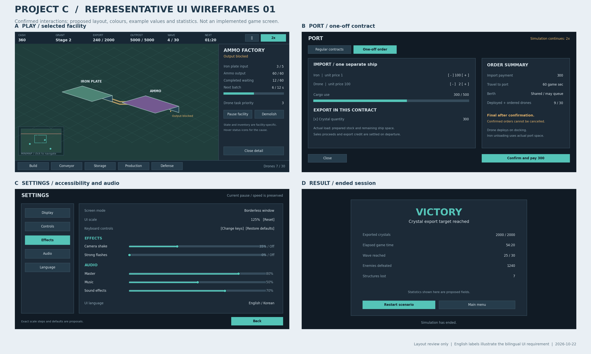

# Project C 기획 작업본

## 현재 작업 상태

- 전환일: 2026-10-23 (한국시간).
- 이 파일을 이후 질의응답의 작업 기준으로 사용합니다.
- 확정 답변: Q-494까지. Q-490~494 답변은1·2·1·1·1로 반영했습니다. 현재 미응답 질문은 없습니다. 사용자 지적에 따라 추가 질문은 목표·범위·예산·중대한 충돌 등 실제 판단이 필요한 사안으로 제한하고 기존 원칙에서 도출 가능한 세부 설계는 AI가 진행합니다.
- 노션: 2026-11-01 Q-494까지 전체 자료 반영·재조회 확인 완료. 원문20개/30개 페이지와 기존10개 페이지의 최신 기준을 확인했습니다. 전체 인계: https://app.notion.com/p/40b7d6829c6a81e9aec2ff8a0b6959b0
- 질문 방식: 기술적인 세부 선택을 상위 원칙처럼 포장해 사용자에게 넘기지 않습니다. 기존 답변·원칙에서 도출 가능한 설계는 AI가 결정하고 근거를 기록합니다. 목표·범위·예산·핵심 경험을 바꾸는 선택, 원칙 간 중대한 충돌, GR-469·484의 실제 제약/자산 부족처럼 사용자 판단이 필요한 사안만 질문합니다. 사용자 답변·도출 설계·미응답 제안은 구분합니다.
- 여러 중요한 질문이 실제로 필요할 때 묶어서 제시합니다. 기존5~10개·10묶음 선호를 채우려고 불필요한 질문을 만들지 않습니다. 답변은 이 파일에 즉시 기록하고 동기화 대기 범위를 갱신합니다.
- 연속 질의 기록: [question-cycle.md](question-cycle.md). Q-415~464의10묶음과 일괄 동기화는 완료했습니다. 이후 사용자의 질문 재개 지시에 따라 Q-465부터 개발 환경·인계·큰 소프트웨어 구조를 검토합니다.
- 엔진은 Q-480에서 Unity+C#으로 확정했습니다. Q-481의 표현 방식은 고정 카메라로 보는 3D 모델에 픽셀 느낌을 적용하는 방식입니다. 실제 개발 머신에서의 설치·연결·실행은 아직 확인하지 않았습니다.
- 에셋 예산: MVP 전체 총 50,000원 이내. AI 구현·수정·검증 용이성이 엔진 평가 1순위, 무료·저가 에셋 선택 폭이 2순위입니다.
- 기존 게임 규칙 요약: [planning-baseline.md](reference/planning-baseline.md). 과거 질의: [planning-history.md](reference/planning-history.md).
- 본문은 현재 확보한 UI 명세에 최신 답변을 합친 작업본입니다. 과거 설명과 상단 최신 GR이 다른 경우 최신 사용자 답변과 GR을 우선합니다.
- 대표 플레이 흐름: [play-flow.md](play-flow.md). 확정 수치를 바꾸지 않고 준비·확장 흐름을 검토한 설계 초안입니다.
- 화면 흐름 명세: [ui-flow.md](ui-flow.md). 안내·시설 목표·항구·설정·취소 동작과 수락 시나리오를 연결했습니다. Q-410~414 확정 동작과 구현 후 확인할 수락 시나리오30개를 관리합니다.
- 통합 검토: [review.md](review.md). 문서 대조·수치 계산을 수행했으며 실제 게임 구현·플레이·성능 검증은 아직 수행하지 않았습니다.

## 개발 환경·인계 결정 — Q-465~469 확정

- 실제 개발은 이 임시 환경이 아닌 다른 머신의 Codex 세션에서 진행합니다. 임시 환경의 도구 설치 여부를 엔진 선택 근거로 사용하지 않습니다. 엔진 선택 단계에서 정확한 버전 확인·설치를 필수로 두지 않고 선택에 영향을 주는 호환 요건만 확인합니다.
- GR-465 (Q-465): 실제 개발 머신의 운영체제는 Windows입니다. 구체 버전·사양·설치 상태는 아직 확인하지 않았습니다.
- GR-466 (Q-466): 개발 도구의 설치·로그인·연결 등 초기 설정부터 가능한 한 AI가 처리하는 방식을 우선합니다. 모든 초기 설정을 AI만으로 완료할 수 있다고 보장하는 결정은 아니며, 실제로 사람이 해야 하는 절차가 발견되면 설명합니다. 자산의 AI 열람·수정·검증 원칙은 유지합니다.
- GR-467 (Q-467): 코드와 Markdown 문서를 Git 저장소에 함께 관리해 다른 머신·Codex 세션으로 인계합니다. 실제 저장소 생성·선택·원격 게시를 완료한 것은 아닙니다.
- GR-468 (Q-468): 사용자 보충 답변은 ‘큰 SW 구조는 미리 설계’입니다. 코드 구조·도구 선택까지 개발 전에 인계 자료로 정리하는 방향을 택하며, 큰 모듈의 책임·연결과 주요 기술 선택을 먼저 설계합니다. 모든 클래스·함수의 사전 확정을 요구하는 것으로 확대 해석하지 않습니다.
- GR-469 (Q-469): 실제 개발 머신에서 선택 엔진의 중요한 제약이 발견되면 사용자에게 질문합니다. 원인·영향·가능한 대응을 정리하고 엔진 교체나 요구 변경을 임의로 확정하지 않습니다. 일반적인 구현 오류 수정까지 매번 질문하도록 확대하지 않습니다.
- 이 절 작성 시점에는 엔진 확정 전이었습니다. 이후 Q-480에서 Unity+C#을 확정했으며 설치·연결·게임 구현은 아직 수행하지 않았습니다.

## 구조 설계 원칙 — Q-470~474 확정

- GR-470 (Q-470): 재고·거래·전투 판정은 화면 없이도 실행·검증할 수 있게 설계하고 엔진은 입력·화면·소리를 담당합니다. 이 답변 당시 언어·엔진은 미정이었으며 이후 Q-480에서 Unity+C#으로 확정했습니다. 구체 실행 도구 구성은 실제 개발 머신에서 확인합니다.
- GR-471 (Q-471): 가격·레시피·시설·웨이브 수치를 데이터로 모으고 작동 규칙은 코드로 관리합니다. 현재 확정 수치를 바꾸거나 사용자용 편집기·모드 기능을 추가하는 결정은 아닙니다.
- GR-472 (Q-472): 버전·초기 조건·주요 명령·오류 상태를 개발용 기록으로 남겨 다른 Codex 세션의 버그 재현을 돕습니다. 전체 판의 모든 입력을 완전히 재생하는 기능을 필수화하지 않습니다. 플레이어의 중도 저장·불러오기 미지원은 유지합니다.
- GR-473 (Q-473): 시설·품목·적 추가와 수치 변경이 쉬운 구조까지 준비합니다. 모드·멀티플레이·여러 지도를 위한 범용 기반을 미리 구현하지 않습니다. MVP 콘텐츠 추가를 승인하는 결정은 아닙니다.
- GR-474 (Q-474): 개발 세션 인계 전 주요 모듈·책임·데이터 흐름·실행 순서·검증 경계를 문서와 도식으로 설계합니다. 주요 인터페이스·데이터 형식 전체나 클래스·함수 단위의 상세 명세는 필수 선행 산출물로 요구하지 않습니다.
- 위 답변에서 도출한 엔진 공통 구조 초안은 [software-architecture.md](software-architecture.md)에 기록합니다. 초안의 개별 설계를 사용자 확정 답변으로 표시하지 않습니다.

## 개발 전환 원칙 — Q-475~479 확정

- GR-475 (Q-475): 이 기획 세션에서 요건 비교를 마쳐 엔진을 선택하고 실제 개발 머신에서 연결·실행을 확인합니다. 선택지1을 채택했으며 실제 개발 세션으로 최종 선택을 넘기는 제안은 채택하지 않았습니다. 현재 임시 환경의 설치 여부는 판단 근거로 쓰지 않습니다.
- GR-476 (Q-476): 개별 흐름은 시간을 줄인 개발용 시험 상황으로 확인하고, 한 판 완성 판정은 확정 시간표·수치로 검증합니다. 짧은 시험의 수정값을 정식 플레이에 반영하지 않습니다.
- GR-477 (Q-477): 검증판의 진단 기록을 로컬 파일로 자동 기록하고 피드백 때 AI가 함께 분석합니다. 다른 머신의 파일을 이 세션이 자동으로 읽을 수 있다는 의미는 아니며 실제 개발 세션에서 접근 가능한 기록으로 인계합니다. 외부 자동 전송은 이 답변의 범위가 아닙니다.
- GR-478 (Q-478): 재고·거래·승패의 정확성 문제는 수정·재검증을 기능 확장보다 우선합니다. 결함이 남은 상태에서 새 기능으로 진행을 대체하지 않습니다.
- GR-479 (Q-479): 첫 Windows 실행 버전은 압축을 풀고 바로 실행하는 ZIP 패키지로 제공합니다. 실행 파일과 필요한 데이터·런타임 구성 요소를 함께 묶으며 단일 EXE만으로 동작해야 한다는 뜻은 아닙니다.
- 엔진 비교 근거와 Q-480의 Unity+C# 확정은 [engine-review.md](engine-review.md)에 기록했습니다.

## 엔진·표현·지원 범위 — Q-480~484 확정

- GR-480 (Q-480): Unity+C#을 채택합니다. 기존 Unity/Phaser 선택 유보를 종료하고 이후 설계·인계를 Unity 기준으로 구체화합니다. 실제 개발 머신의 설치·연결·실행 확인과 엔진 제약 발견 시 사용자 질문 원칙은 유지합니다.
- GR-481 (Q-481): 3D 모델을 고정 카메라로 보여주고 픽셀 느낌으로 표현합니다 (선택지2). 2D 스프라이트/아이소메트릭 타일맵을 기본 구현으로 권고한 선택지1은 채택하지 않았습니다. 기존 고정 쿼터뷰·카메라 회전 금지·이동/줌·시설90도 회전과 산업/군사·중간 묘사·가벼운 사용감 기준은 유지합니다. 실제 이동·공격·충돌·점유 크기를 3D 모델 외형에 맞춰 변경하는 결정은 아닙니다.
- GR-482 (Q-482): 첫 Windows판은 일반적인 Intel·AMD 기반 x64 PC부터 지원·검증합니다. Windows10/11·1080p·내장GPU·RAM8GB·전 배속60FPS 목표는 유지합니다. Windows on ARM의 별도 지원·검증을 이번 범위에 추가하지 않습니다.
- GR-483 (Q-483): 핵심 게임 규칙은 AI가 구현하고 기반 기능에는 용도·사용 조건을 확인한 무료 패키지를 활용할 수 있습니다. 공식 패키지로만 제한하지 않되 실제 프로젝트와 적합성을 확인합니다. 유료 코드·도구 구매나 추가 설치 완료를 뜻하지 않습니다.
- GR-484 (Q-484): 무료 자산과 보정으로 필요한 시설·유닛 표현을 확보하기 어려우면 해당 자산을 고르기 전에 사용자와 대안을 먼저 논의합니다 (선택지3). AI 신규 자산 제작·유료 그래픽 구매·음향 예산 재배분을 임의 대체 경로로 확정하지 않습니다. 실제 부족 여부는 아직 조사·검증하지 않았습니다.
- 상태: 로컬 반영 완료·노션 동기화 대기. Unity 프로젝트 생성·실제 모델 선별/가공·플레이/성능 검증은 미착수입니다.

## 3D 표현 원칙 — Q-485~489 확정

- GR-485 (Q-485): 지도·시설·유닛 장면에 픽셀 느낌을 적용하고 UI·글자는 선명하게 유지합니다. 지도 픽셀 표현과 UI 배율은 분리하며 구체 효과 방식·내부 해상도·픽셀 크기는 기술설계와 실제 시각 검증에서 도출합니다.
- GR-486 (Q-486): 먼 곳과 가까운 곳의 크기가 같은 직교 투영으로 배치·물류 읽기를 우선합니다. 고정 쿼터뷰·카메라 방향 회전 금지와 이동·줌은 유지합니다. 카메라의 구체 각도·확대 단계는 이 답변으로 고정하지 않습니다.
- GR-487 (Q-487): 기능·형태가 잘 읽히는 일정한 조명과 절제된 그림자를 사용합니다. 강한 대비 연출이나 밤낮 변화의 추가를 요구하지 않습니다.
- GR-488 (Q-488): 모델의 형태·높이로 가림을 줄이고 선택 대상은 윤곽으로 강조합니다. 기존 지도 배치·시설 점유 규칙을 임의 변경하지 않습니다. 모든 가림에 대한 자동 반투명 처리를 기본 요구로 채택하지 않았으며 윤곽의 구체 표시 방식은 후속 설계에서 정합니다.
- GR-489 (Q-489): 첫 작은 전체 흐름 검증판에서 대표 시설·지형에 새3D·픽셀 표현을 적용해 함께 검토합니다. 임시 그래픽·기본 UI로 흐름부터 확인하는 원칙을 유지하고 모든 정식 모델·정교한 효과를 먼저 완성하도록 확대하지 않습니다.
- 상태: 로컬 반영 완료·노션 동기화 대기. 실제 렌더 파이프라인·셰이더·모델 가공·성능 검증은 미착수입니다.

## 제작·검증 원칙 — Q-490~494 확정

- GR-490 (Q-490): 시각 연출이 성능 목표와 충돌하면 그림자·후처리·장식 효과부터 단순화하고 기능 식별·게임 규칙을 유지합니다. 기존 픽셀 표현 방향과 성능 목표를 없애는 결정은 아닙니다.
- GR-491 (Q-491): 코드·기획·자산 인계의 Git 저장소는 공개 저장소로 관리합니다 (선택지2). 실제 저장소 생성·원격 게시를 완료한 것은 아닙니다. 자산은 기존 실제 사용·보관/배포 조건이 허용하는 범위에서 적용합니다.
- GR-492 (Q-492): 한 가지 기본 분위기의 배경음악을 자연스럽게 반복합니다. 기존 차분한 산업·전자음악 방향·음량 설정·에셋 예산과 음향 우선 배분을 유지합니다.
- GR-493 (Q-493): 여러 합리적인 배치와 증설 순서로 완주할 수 있음을 밸런스 검증 기준으로 사용합니다. 현재 지도·규칙·승리 조건·확정 수치를 바로 바꾸거나 모든 배치의 성공을 보장하지 않습니다.
- GR-494 (Q-494): 원본·가공 방법·최종본을 함께 보관해 다음 Codex 세션의 AI가 다시 수정·검증할 수 있게 합니다. 실제 사용·보관 권한을 확인한 범위에서 적용합니다.

## 질문 방식 교정 — 사용자 지적 반영

- 사용자는 최근 질문이 높은 수준의 사용자 확인이 필요한 질문인지 지적했습니다. 최근 묶음에는 사용자 판단과 AI가 도출할 기술/관리 선택이 섞여 있었습니다.
- 예를 들어 최적화 순서·원본/가공본 관리 같은 항목은 기존 성능·자산/인계 원칙에서 도출해 설계자가 책임질 수 있었습니다. 새 질문을 만들기 전에 기존 결정으로 해결 가능한지 확인합니다.
- 사용자 답변1·2·1·1·1은 위 GR-490~494로 보존하며, 앞으로의 질문 필요성 기준을 강화합니다. 이 교정을 새 게임 규칙 번호나 새로운 질의 묶음으로 계산하지 않습니다.
- 현재 사용자 판단이 필요한 새 충돌은 확인하지 않았습니다. Q-495 이후의 묶음을 임의로 생성하지 않고 확정 원칙으로 설계·인계 문서를 구체화합니다.
- 다음 개발 세션의 단일 진입 문서: [development-handoff.md](development-handoff.md). 문서 인계 준비와 실제 저장소·Unity 프로젝트·검증 실행 상태를 구분합니다.

## 노션 동기화 결과 — Q-464까지 완료한 이력

- 결정 색인·UI·공통 규칙·생산/물류·비기능·진행 기록·기존 검토 명세·엔진 검토8개 페이지를 갱신하고, 공통 원칙/검증/제작 계획 페이지를 생성했습니다. 쓰기 성공과 재조회 내용을 확인했습니다.
- 기존 상세 명세 묶음: https://app.notion.com/p/4027d6829c6a810b8089d8a75a22a506
- 완료 요약·공통 원칙·검증/제작 계획: https://app.notion.com/p/40b7d6829c6a8109809df1a5c2fe805e
- 동기화 확인 기록: notion-sync-receipt.json. 이번 주기 전체 기록은 notion-sync-cycle-complete-receipt.json.
- 위 페이지는 Q-464 기준으로 갱신·재조회한 이력입니다. 이후 Q-480에서 Unity+C#을 확정했습니다. 최신 미반영 답변과 미응답 질문은 파일 상단을 따르며 게임 구현·플레이/성능 검증은 아직 수행하지 않았습니다.

## 이번 동기화 완료 — Q-435~464

- Q-435~439 / GR-435~439: 재탐색·재시도 자동/새 구매·배치 변경 직접, 결과·비용 사전 표시/즉시 실행, 원인과 가능한 조치 안내, 초반 학습·중반 증설·후반 한계 시험, 신규 기능은 핵심 한 판 완성에 필수인 경우만 포함. 노션 반영 완료.
- 원칙에서 도출한 세부 설계는 [design-principles.md](design-principles.md)의 DD 항목으로 구분합니다. 새로운 사용자 답변으로 표시하지 않습니다.
- Q-440~444 / GR-440~444: 작은 전체 흐름 우선, 작은 실수 복구 여유, 핵심 규칙 유지/수치·배치부터 검토, 직접 플레이+핵심 지표, 임시 그래픽·기본 UI 우선. 노션 반영 완료.
- [first-validation.md](first-validation.md)에 위 원칙에서 도출한 첫 검증 계획을 정리했습니다. 개발 착수·엔진 선택·수치 변경·검증 완료를 뜻하지 않습니다.
- Q-445~449 / GR-445~449: 현재·다음 국면 중심 정보, 드론 보조/벨트 대량 운반 주력, 정지를 활용한 계획형 플레이, 피해 감수 전략 허용, 후반 생산·수송 용량/공간 병목 목표. 노션 반영 완료.
- Q-450~454 / GR-450~454: 기능 식별을 위한 외형 과장, MVP 그래픽은 무료 자산+보정 기반, 픽셀 선명함/줌 단계 우선, 구매 예산은 음악·효과음 우선, AI 열람·수정·검증 가능한 자산만 선정. 노션 반영 완료.
- [asset-plan.md](asset-plan.md)에 자산 선별·보정·예산·표현 검증의 도출 기준을 정리했습니다. 실제 자산 조사·구매·제작 결과는 아닙니다.
- Q-455~459 / GR-455~459: 개발/초기 검증 환경 자유, 초기 브라우저 미리보기 허용/최종 Windows 검증, 엔진은 요건 검토 후 하나 선택, 핵심 규칙 자동 검증 우선, 작은 전체 흐름 이후부터 후반/4배속 부하 검증 병행. 노션 반영 완료.
- [technical-validation.md](technical-validation.md)에 엔진 검토 근거·초기/최종 환경 구분·자동 검증/성능 계획을 도출했습니다. 실제 엔진 선택·설치·실측 결과는 아닙니다.
- Q-460~464 / GR-460~464: 본인 외 테스트는 MVP 기능/기본 표현 완성 후, 한 판 완수 성취 우선, 사용자 자유 플레이/기록 AI 정리, 독립 Windows판 우선/상점 연동 후속, 작은 실행 버전+변경/검증 결과 단위 검토. 노션 반영·재조회 검증 완료.
- [cycle-summary.md](cycle-summary.md)에10묶음·50개 답변과 다음 단계의 도출 순서를 요약했습니다. 현재 미응답 질문은 없습니다.

## 최근 동기화 — Q-425~434 반영 완료

- Q-425~429 / GR-425~429: 개별 건설 보류 기능 제외, 예정지 수정은 취소 후 재배치, 중복 수리 요청 유지, 시설 상세에 겹친 회수물 별도 표시, 철거 취소 후 수리 허용. 노션 반영 완료.
- Q-430~434 / GR-430~434: 필터 즉시 반영, 분배기·합류기 각1개 용량, 기존 벨트 직접 방향 변경, 기존 벨트 중첩은 전체 경로 확정 차단, 장치 교체는 철거 후 건설. 노션 반영 완료.
- 위 동기화 시점에는4/10묶음 완료·Q-435~439 제안 상태였습니다. 현재 진행 상태는 파일 상단을 따릅니다.

## 지난 노션 일괄 반영 내역 — Q-424까지 완료

- Q-380~384 / GR-380~384: 웨이브 예고·전초기지 피격은 화면으로만 알림, 선박 실제 접안·출발 모두 알림음, 선택한 생산 시설만 기계 가동음, 차분한 산업·전자음악 BGM. 노션 반영 완료.
- Q-385~389 / GR-385~389: 정기 계약 적용 버튼, 단발주문 요약/버튼만으로 확정, 슬라이더+숫자 직접 입력, 선박 상태별 목록, 이번 판 전체 거래 내역. 노션 반영 완료.
- Q-390~394 / GR-390~394: 배치·선택 중 포트 표식, 시설 그림에서 포트 선택 후 품목 필터 체크, 우선순위1~5 가로 버튼, 품목별 재고 표/수량 종류별 열, 자재 부족 건설 예정지는 경고 목록 제외. 노션 반영 완료.
- Q-395~399 / GR-395~399: 일시정지 Space, 시설 회전 R, 컨베이어 꺾임 순서 전환 Q, 배치 취소 우클릭/Esc, UI 배율75·100·125·150%와 기본100%. 노션 반영 완료.
- Q-400~404 / GR-400~404: 배속 F1·F2·F3, 언어 적용 버튼, 소리/효과 즉시 반영, 화면 모드/UI 배율 자동 복원 없음, 분류별·전체 기본값 복원 모두. 노션 반영 완료.
- Q-405~409 / GR-405~409: 벨트 방향 보조 표시 없음, 선박 대기 순번·경과 시간, 이후 새 판의 안내 자동 표시 없음, 설정 재실행 후 유지, 적용하지 않은 입력은 창을 닫으면 폐기. 노션 반영 완료.
- 대표 플레이 흐름 초안: 첫300초 준비·초기 철 배분·수출 증설·후속 구현 검증 항목을 정리했습니다. 노션 반영 완료.
- 화면 흐름 명세 초안: 안내 단계 감지·시설 재고/목표·항구 상태·설정 적용·취소 문맥과 수락 시나리오20개를 정리했습니다. Q-410~414 답변을 반영하고 상태 전이 표를 보완했습니다. 노션 반영 완료.
- Q-410~414 / GR-410~414: 같은 판 안내의 달성 단계 건너뛰기, 배속 선택으로 정지 해제·재개, 보충 목표 적용 버튼, 철거된 안내 대상의 같은 종류 시설 자동 대체, 활성 필터의 빈 체크는 전체 차단. 노션 반영 완료.
- Q-415~419 / GR-415~419: 수출 승리 출발 시각3900초 미만, 치명 피해와 수리 동시 발생 시 파괴 우선, 동거리 표적은 먼저 등장한 적, 취소/완공 동시 시 취소 우선, 같은 진입점은 이전 웨이브 대기부터 생성. 노션 반영 완료.
- Q-420~424 / GR-420~424: 작업 우선순위/생성 시각 동률 시 시작 위치 거리, 자재 대기 후 원래 순서 유지, 현장 작업도 대상 시설 우선순위 사용, 시작 위치에 가까운 유휴 드론 배정, 드론끼리 겹쳐 통과. 노션 반영 완료.
- 통합 검토 기록: 수출 생산량·웨이브 시간표·탄약 수요·선박 처리시간을 계산하고 연결 동작의 보완 질문5개를 도출했습니다. 노션 반영 완료.
- 작업 방식 변경: 답변마다 노션을 갱신하지 않고 로컬 MD에 누적한 뒤 일괄 반영합니다.
- 후속 사용자 지시:10묶음 질의를 이어간 뒤 요약하고 노션을 일괄 업데이트합니다. 2/10묶음까지 Q-415~424를 확정한 뒤 최신 사용자 지시로 중단하고 노션 일괄 반영·검증을 완료했습니다. Q-425~429는 작성만 한 보류 초안입니다.

---

- 원본 기획: [20261014 project C](https://app.notion.com/p/3f97d6829c6a81a2999decb377794963)
- 상태: Q-464까지 확정·연속 질의10/10묶음 완료·누적 요약/노션 반영·검증 완료·미응답 없음. Unity/Phaser 후보 유지·엔진 선택 유보·구현/실측 미착수.
- 진행 기록: [관련 문서](https://app.notion.com/p/3fe7d6829c6a815e8c2ed815c6600ec1)

### 대표 플레이 화면 시각 시안01 — 검토용

- 2026-10-23 채팅에 대표 플레이 화면 시안01을 제시했습니다. 현대 산업·군사 장비 / 생물형 적 / 픽셀 아트 방향 / 초원·흙·암석 / 미래형 전술 UI를 함께 검토합니다.
- 상단 HUD·오른쪽 시설 상세·경고 목록·좌하단 미니맵·하단 건설 메뉴를 조합했습니다. 시안의 예시 상태·시설 배치·연결은 실제 게임 구현이나 확정 지도 좌표 검증 결과가 아닙니다.
- 후속 Q-353부터 Q-355에서 중간 수준의 세밀함·시설별 고유 형태·짙은 남색/청록 UI를 확정했습니다. 정확한 픽셀 크기·색상 코드·UI 선 두께는 후속 시안에서 검토합니다.
- 다음 진행: 사용자 시안 피드백을 반영해 대표 화면 디자인 기준을 구체화합니다. 새 미응답 질의 묶음은 없습니다.

## 최신 기획 결정 — Q-353부터 Q-464까지 확정

- 최신 반영일: 2026-11-01. Q-464까지 확정했고 테스트·배포·후속 검토 주기를 반영했습니다. 10/10묶음을 완료했으며 현재 미응답 질문은 없습니다. 질문은 한 번에5개 이상10개 이하로 제시합니다. Unity·Phaser 후보 유지와 엔진 선택 유보는 유지합니다.
- GR-353 (Q-353): 시설·유닛의 픽셀 아트는 기계 구조가 보이는 중간 수준의 세밀함으로 정합니다. 정확한 원본 픽셀 크기는 자산 시안과 화면 확대·축소 검토에서 정합니다.
- GR-354 (Q-354): 철판 설비·탄약 공장·정제 시설은 고유한 형태와 대표 장치를 중심으로 외형을 구분합니다.
- GR-355 (Q-355): 미래형 전술 UI의 기본 색상은 짙은 남색 바탕·청록 강조로 정합니다. 경고는 아이콘·문구도 함께 표시합니다. 정확한 색상 코드는 후속 시안에서 구체화합니다.
- 이전 시안01의 색상·세부 묘사 제안은 위 결정에 맞춰 후속 시안에서 조정합니다. 서체·아이콘·선 두께·패널 폭은 아직 세부 검토 항목입니다.

### 적·장비·가동 표현 — Q-356부터 Q-358까지 확정

- GR-356 (Q-356): MVP 생물형 적 1종은 낮은 몸통과 여러 다리를 가진 곤충형으로 정합니다. 기존 이동·공격·충돌 크기를 적용합니다.
- GR-357 (Q-357): 시설·장비는 약간의 흠집·때가 있는 사용감으로 표현합니다.
- GR-358 (Q-358): 생산 시설의 가동 상태는 작은 기계 동작과 표시등으로 표현합니다.
- 대표 플레이 화면 시안02: Q-358까지의 기준을 적용한 생성 이미지를 채팅에 제시했습니다. 시설별 대표 장치·사용감·곤충형 적·남색/청록 UI를 함께 검토합니다. 화면의 배치·예시 수치·픽셀 크기는 최종 자산 규격이나 구현 검증 결과가 아닙니다. 가동 동작은 정지 장면으로 표현했습니다.
- GR-359 (Q-359): 대표 플레이 화면 시안02의 현재 시설·유닛 묘사 수준을 실제 자산 제작의 시각 기준으로 채택합니다. 정확한 픽셀 크기·애니메이션 프레임·UI 치수는 자산 제작 및 기술설계에서 구체화합니다.

### 다음 재개 지점 — 기술설계 준비

- 아트의 기본 방향과 대표 자산 묘사 수준이 정리되어 다음은 엔진·언어·2D/3D 표현 방식 검토입니다. 지도 배치·예시 수치·물류 연결 전체를 시안02의 승인으로 확정하지 않습니다.
- 기술설계에서 확정 기획·Windows10/11·내장 GPU·시스템 RAM8GB·1080p 전 배속60FPS 목표를 근거로 엔진 후보, 시뮬레이션/화면 표시 분리, 상태·재고 소유권, 경로 탐색과 검증 계획을 정리합니다.
- GR-360 (Q-360): Unity·Godot와 JS 기반 개발 경험이 있으며 직접 코드 작성이 아니라 AI를 이용했습니다. 엔진 선택은 1순위 AI의 구현·수정·검증 용이성, 2순위 무료·저가 에셋의 선택 폭으로 평가합니다.
- 기술설계 초안: [관련 문서](https://app.notion.com/p/4027d6829c6a819484e2c617a2bf19f3). Unity MCP/CLI와 Phaser를 비교한 검토 이력입니다. GR-362에 따라 Unity·Phaser를 모두 후보로 유지하며 제약조건 구체화 후 다시 판단합니다. 설치·연동·구현·실측은 미실행입니다.
- GR-361 (Q-361): MVP 전체 에셋 구매 예산은 이미지·애니메이션·UI·음향을 합하여 총50,000원 이내로 정합니다.
- 최신 예산 원칙: GR-451·453에 따라 MVP 그래픽은 무료 자산+보정 기반이며 구매 예산은 음악·효과음 완성도에 우선 배분합니다. 이전 시설·적 그래픽 구매 우선 제안은 이 결정으로 대체합니다. 전체5만원 상한과 자산별 실제 사용 조건 확인은 유지합니다.
- GR-362 (Q-362): Unity + C#와 TypeScript + Phaser를 모두 구현 후보로 유지합니다. 기술 제약조건·개발 환경·AI 연동·에셋 적합성 등이 더 구체화되면 다시 비교하여 판단합니다. 현시점에서 어느 한쪽을 채택하거나 우선 검증 엔진으로 확정하지 않습니다. 현재는 기획을 재개합니다. 기존 추천 비교는 검토 이력입니다.

### 경고 표시 상세 — Q-363부터 Q-365까지 확정

- GR-363 (Q-363): 시설 문제가 해결되면 경고 목록의 해당 항목을 즉시 자동 제거합니다.
- GR-364 (Q-364): 여러 시설의 같은 종류 경고는 경고 유형별로 묶고 시설 목록을 펼쳐 확인합니다. 개별 시설 항목을 누르면 해당 위치로 카메라를 이동합니다.
- GR-365 (Q-365): 한 시설에 여러 문제가 동시에 있으면 시설 위에 문제 아이콘을 모두 나란히 표시합니다. 중요한 문제1개와 개수로 축약하거나 아이콘을 번갈아 표시하는 안은 채택하지 않습니다. 호버 설명과 오른쪽 상세 패널에서도 전체 원인을 확인합니다.
- 기존 시설 상태 아이콘·호버 설명·오른쪽 상세 패널·경고 목록의 원인 연결을 유지합니다. 경고 유형별 묶음은 해당 유형의 활성 문제가 있는 시설을 대상으로 갱신합니다.

### 결과 통계 집계 — Q-366부터 Q-367까지 확정

- GR-366 (Q-366): 결과 화면의 플레이 경과 시간은 배속을 반영한 게임 시간으로 표시합니다. 일시정지한 시간은 누적하지 않습니다.
- GR-367 (Q-367): 결과 화면의 도달 웨이브는 시작한 웨이브 번호를 기준으로 표시합니다. 12회차 전투 도중 종료하면12/30이며 첫 웨이브 시작 전 종료는0/30입니다. 완료/적 전원 처치 횟수로 대체하지 않습니다. 기존 웨이브 시간표와 잔존 적 허용 규칙은 유지합니다.
- 기존 최종 수출량·목표 달성률·플레이 경과 시간·도달 웨이브·적 처치 수의5개 통계 항목을 유지합니다.

### 취소·게임 메뉴 — Q-368부터 Q-369까지 확정

- GR-368 (Q-368): 배치 중이거나 창이 열려 있을 때 기본 Esc 입력은 배치 취소·창 닫기를 우선 처리합니다. 취소하거나 닫을 현재 작업/창이 없으면 게임 메뉴를 엽니다. 이 취소 입력만으로 이미 확정된 건설 명령을 철거하거나 취소하지 않습니다.
- GR-369 (Q-369): Esc로 게임 메뉴를 열고 닫아도 현재 배속/일시정지 상태를 유지합니다. 필요하면 플레이어가 직접 일시정지합니다. 메뉴 열기만으로 자동 정지하거나 닫기만으로 임의 재개하지 않습니다.
- 항구 등 관리 화면·설정 화면의 기존 배속 유지와 포커스 상실 시 진행 규칙을 함께 유지합니다.

### 첫 안내·경고·미니맵 — Q-370부터 Q-374까지 확정

- GR-370 (Q-370): 첫 플레이 안내의 마지막 ‘터렛 보급’ 단계는 터렛에 탄약이1개 이상 실제 도착하면 완료합니다. 첫 발 발사나 첫 적 처치를 기다리지 않습니다. 기존 전투 시작 시각·보급·탄약 소비 규칙을 유지합니다.
- GR-371 (Q-371): 안내를 건너뛴 뒤 같은 판에서도 게임 메뉴에서 다시 켤 수 있습니다. 안내를 다시 표시해도 판을 초기화하거나 자원을 추가하지 않습니다.
- GR-372 (Q-372): 단계별 안내는 화면 한쪽의 목표 패널과 해당 대상 강조로 표시합니다.
- GR-373 (Q-373): 경고 목록의 유형별 묶음은 긴급도 높은 순으로 정렬합니다. 해결 즉시 제거·유형별 묶음/시설 목록 펼치기·개별 시설 클릭 시 위치 이동을 유지합니다.
- GR-374 (Q-374): 미니맵에 항구·전초기지, 터렛, 생산·채취·정제 시설, 일반 창고, 컨베이어·분배기·합류기를 모두 표시합니다. 적·경고·현재 카메라 범위와 클릭 위치 이동도 유지합니다.

### 지도 정보 표시 — Q-375부터 Q-379까지 확정

- GR-375 (Q-375): 전투지역 시설의 체력바는 손상되었거나 선택했을 때 표시합니다. 생산지역 시설에는 체력/체력바를 추가하지 않습니다.
- GR-376 (Q-376): 적 유닛의 체력바는 피해를 받은 적에게만 표시합니다.
- GR-377 (Q-377): 터렛 사거리는 터렛 배치·선택 중에만 표시합니다. 사거리 수치와 산에 의한 직사 차폐 규칙은 유지합니다.
- GR-378 (Q-378): 지도 위 격자선은 건설 배치 중에만 표시합니다.
- GR-379 (Q-379): 컨베이어 운반 방향은 컨베이어의 이동 애니메이션으로 표현합니다. 방향 화살표는 표시하지 않습니다. 배치/선택 중 화살표 표시나 화살표 켜기·끄기 안을 채택하지 않습니다. 기존 운반 방향·처리량은 유지합니다.

### 사운드·중요 알림 — Q-380부터 Q-384까지 확정

- GR-380 (Q-380): 웨이브 시작30초 전 예고는 기존 등장 지점의 화면 강조만 사용하며 예고 경고음은 제공하지 않습니다. 웨이브 시간표를 유지합니다.
- GR-381 (Q-381): 전초기지 피격 경고는 화면으로만 제공하며 별도 피격 경고음은 제공하지 않습니다. 실제 공격·피해 규칙을 유지합니다.
- GR-382 (Q-382): 선박은 실제 접안과 실제 출발 시 모두 알림음을 제공합니다. 항구 밖 도착·접안 대기와 실제 접안을 구분합니다. 선박 일정·정산 규칙은 유지합니다.
- GR-383 (Q-383): 생산 시설의 기계 가동음은 선택한 시설만 들려줍니다. 단순히 카메라 근처에 있다는 이유로 다른 생산 시설의 가동음을 함께 재생하지 않습니다.
- GR-384 (Q-384): 배경음악은 차분한 산업·전자음악 분위기로 정합니다. 구체 음원은 총5만원 이내의 전체 에셋 예산에서 선정합니다.
- 기존 전체/BGM/효과음 볼륨 조절을 유지하며 선박 알림음·기계 가동음은 효과음에 연결합니다.

### 항구 계약 UI — Q-385부터 Q-389까지 확정

- GR-385 (Q-385): 정기 계약 수량의 편집 내용은 적용 버튼을 눌렀을 때 반영합니다. 이미 확정·선결제한 항차는 유지하고 아직 미확정인 항차부터 적용하는 기존 규칙을 유지합니다.
- GR-386 (Q-386): 단발주문은 주문 화면의 요약과 확정 버튼으로만 확인하며 별도 최종 확인창을 추가하지 않습니다. 확정 전에 품목·수량·금액과 취소 불가를 확인할 수 있게 표시합니다. 실제 확정 시 즉시 결제하고 확정 후 취소할 수 없는 규칙을 유지합니다.
- GR-387 (Q-387): 계약·주문의 수량 입력은 슬라이더와 숫자 직접 입력을 제공합니다. 자금·선박 적재·드론 대수 등의 기존 제약을 유지합니다.
- GR-388 (Q-388): 선박 목록은 접안 중·대기 중·배송 중으로 나누고 각 선박의 상태와 남은 시간을 표시합니다. 기존 운항 시간표와 접안 순서를 변경하지 않습니다.
- GR-389 (Q-389): 배송 완료·환불·수출 정산은 이번 판의 전체 내역을 제공합니다. 판을 넘긴 영구 거래 기록이나 저장/불러오기 기능을 추가하지 않습니다.

### 물류 설정·재고 표시 — Q-390부터 Q-394까지 확정

- GR-390 (Q-390): 시설의 입력·출력 포트 표식은 시설 배치·선택 중에만 표시합니다. 컨베이어 방향 화살표를 표시하지 않는 GR-379를 유지합니다.
- GR-391 (Q-391): 출구별 품목 필터는 시설 그림에서 해당 포트를 선택한 뒤 품목을 체크하는 화면으로 설정합니다. 복수 품목 선택·미설정 시 모든 허용 품목 통과의 기존 규칙을 유지합니다.
- GR-392 (Q-392): 시설의 드론 작업 우선순위는1~5단계 버튼을 한 줄로 표시하여 선택합니다. 5가 최고·미설정은3·다음 신규 작업부터 적용하는 기존 규칙을 유지합니다.
- GR-393 (Q-393): 시설 상세 패널의 재고 정보는 품목별 표로 정리하고 실재고·예약·운반 중 등의 수량 종류를 별도 열로 표시합니다. 수량의 의미와 중복 계산 방지 규칙을 유지합니다.
- GR-394 (Q-394): 자재가 부족해 기다리는 건설 예정지는 예정지 상태 표시·상세 설명으로 안내하고 경고 목록에는 포함하지 않습니다. 자재 부족이어도 유효 위치에 건설 예정지를 놓을 수 있는 기존 규칙을 유지합니다.

### 기본 조작키·UI 배율 — Q-395부터 Q-399까지 확정

- GR-395 (Q-395): 일시정지·재개의 기본키는 Space입니다. 기존 배속·게임 메뉴 시간 규칙과 사용자 키 변경/복원을 유지합니다.
- GR-396 (Q-396): 시설 배치 중90도 회전의 기본키는 R입니다. 카메라 회전은 추가하지 않습니다.
- GR-397 (Q-397): 컨베이어 드래그 중 가로먼저/세로먼저 꺾임 순서 전환의 기본키는 Q입니다. Tab 제안을 채택하지 않습니다. 기존 직각 경로 미리보기·경로 전체 확정 규칙을 유지합니다.
- GR-398 (Q-398): 배치 중 마우스 오른쪽 클릭과 Esc 모두 현재 배치 취소를 지원합니다. 이미 확정한 건설 명령의 취소/철거와 구분합니다. Esc의 문맥별 우선 처리는 GR-368을 유지합니다.
- GR-399 (Q-399): MVP UI 배율은75·100·125·150%의4단계이며 기본값은100%입니다. 변경·기본값 복원을 지원하며 최소1280×720·한국어/영어에서 필수 정보/조작이 잘리지 않는 기존 요구를 검증합니다.

### 기본키·설정 적용 — Q-400부터 Q-404까지 확정

- GR-400 (Q-400): 1배·2배·4배를 직접 고르는 기본키는 각각 F1·F2·F3입니다. Space의 일시정지/재개와 사용자 키 변경·복원을 유지합니다.
- GR-401 (Q-401): 설정 화면의 언어 변경은 적용 버튼을 눌렀을 때 반영합니다. 한국어·영어 지원을 유지합니다.
- GR-402 (Q-402): 소리 크기·흔들림·섬광 설정은 조절 즉시 반영합니다. 기존 전체/BGM/효과음 볼륨과 효과별 조절을 유지합니다.
- GR-403 (Q-403): 화면 모드·UI 배율 변경은 자동 복원 없이 변경값을 유지합니다. 시간 제한 확인창·자동 되돌리기 타이머는 추가하지 않습니다. 최소 화면·지원 언어·모든 지원 UI 배율에서 필수 조작이 가능한 기존 요구를 유지합니다.
- GR-404 (Q-404): 설정의 기본값 복원은 분류별 복원과 전체 복원을 모두 제공합니다. 키 배정·UI 배율 기본값 복원 요구를 유지합니다.

### 통합 검토 보완 결정 — Q-405부터 Q-409까지 확정

- GR-405 (Q-405): 컨베이어 방향을 위한 보조 표시는 추가하지 않습니다. 일시정지 중에도 선택 상세 패널에 동·서·남·북 방향 글자를 표시하지 않으며 지도 위 화살표도 표시하지 않습니다. 기존 벨트 이동 애니메이션은 게임 시간과 함께 정지합니다. 시설 입출력 포트 표식의 GR-390은 별도로 유지합니다.
- GR-406 (Q-406): 접안 대기 선박 목록에는 대기 순번과 기다린 시간을 표시합니다. 기다린 시간은 항구 밖 도착 후 접안 전까지의 게임 시간 경과이며 배속·일시정지에 따릅니다. 추정 접안 잔여 시간은 추가하지 않습니다. 배송 중 도착까지의 시간과 접안 중 체류 잔여 시간은 각 상태에서 표시합니다.
- GR-407 (Q-407): 첫 플레이 안내를 완료하거나 건너뛴 뒤 새 판을 시작하면 안내를 자동 표시하지 않습니다. 게임 메뉴에서 다시 켤 수 있으며 같은 판에서 다시 켜는 GR-371도 유지합니다. 안내를 켜도 판 초기화·자원 추가·자동 건설을 하지 않습니다.
- GR-408 (Q-408): 언어·음량·단축키·UI 배율 등 사용자 설정은 프로그램을 재실행해도 유지합니다. 적용 버튼이 있는 설정은 적용한 값, 즉시 반영하는 설정은 반영된 값을 보존합니다. 한 판의 중도 저장/불러오기 기능을 추가하는 결정은 아닙니다.
- GR-409 (Q-409): 언어·정기 계약처럼 적용 버튼이 있는 항목은 적용하지 않은 채 창을 닫으면 미적용 변경을 폐기합니다. 추가 적용 확인창이나 다시 열 때까지의 임시 보관은 제공하지 않습니다. 마지막으로 적용한 값·이미 확정한 항차/주문·즉시 반영된 소리/효과 설정은 유지합니다. Esc로 닫는 경우에도 같은 규칙을 적용합니다.

### 화면 흐름 보완 결정 — Q-410부터 Q-414까지 확정

- GR-410 (Q-410): 같은 판에서 안내를 다시 켜면 이미 달성한 단계는 건너뜁니다. 이번 판의 실제 반입·생산·보급 이력을 사용하며 안내를 숨기거나 건너뛴 동안의 달성도 포함합니다. 판을 초기화하거나 자원을 추가하지 않습니다. 새 판의 단계 이력은 새로 시작합니다.
- GR-411 (Q-411): 일시정지 중 F1·F2·F3 또는 배속 버튼으로1배·2배·4배를 고르면 선택한 배속으로 즉시 재개합니다. 메뉴를 열고 닫기만 할 때에는 배속/정지를 유지하는 GR-369와 구분합니다.
- GR-412 (Q-412): 전초기지·창고의 드론 보충 목표 재고는 적용 버튼을 눌렀을 때 반영합니다. 편집 중에는 마지막 적용 목표로 보충하며, 미적용 상태에서 해당 창을 닫으면 편집값을 폐기하는 GR-409를 적용합니다. 실제 적용 후 픽업 전 작업 조정·적재 화물 처리에는 기존 목표 변경 규칙을 사용합니다.
- GR-413 (Q-413): 안내 대상 생산 시설이나 터렛을 철거했는데 같은 종류의 시설이 남아 있으면 안내 대상을 해당 종류의 남은 시설로 자동 전환합니다. 대체 시설이 없으면 해당 시설이 필요하다고 안내합니다. 이미 달성한 단계 이력은 유지하며 시설을 자동 건설하지 않습니다.
- GR-414 (Q-414): 품목 필터를 켠 상태에서 체크를 모두 해제하면 해당 출구에서 모든 품목을 차단합니다. 체크0개를 미설정/전체 허용으로 자동 전환하지 않습니다. 필터 미설정 상태는 기존대로 시설에서 허용하는 모든 품목을 통과시킵니다. 미설정과 활성 필터의 빈 목록을 별도 상태로 구분합니다.

- 연결 명세: [ui-flow.md](ui-flow.md). 안내 이력·배속·목표 편집·필터 상태 표와 수락 시나리오20개를 보완했습니다. 실제 게임·UI 구현 검증 결과는 아닙니다.

### 사건 경계 보완 결정 — Q-415부터 Q-419까지 확정

- GR-415 (Q-415): 수출 승리는 게임 시간3900초 전에 실제 선박 출발로 누적 결정2000개를 달성해야 합니다. 정확히3900초인 출발은 승리로 인정하지 않습니다. 같은 시점 전초기지 파괴는 기존대로 패배 우선입니다. 기한 비교는3900초 미만이며 배속·일시정지에 따른 실제 시간과 구분합니다.
- GR-416 (Q-416): 같은 시점에 전투 시설의 체력을0으로 만드는 공격 피해와 드론 수리 회복이 발생하면 파괴를 우선합니다. 해당 수리로 시설을 되살리지 않습니다. 생산지역 시설에 체력을 추가하는 규칙은 아닙니다.
- GR-417 (Q-417): 터렛의 가장 가까운 유효 적 후보가 동거리이면 먼저 등장한 적을 우선합니다. 가장 가까운 살아 있는 유효 적 우선·매 발사 재선택·사거리/산 차폐 규칙을 유지합니다. 등장 시각까지 같을 때의 최종 동률은 기술설계에서 일관되게 처리합니다.
- GR-418 (Q-418): 건설 취소 명령과 완공이 같은 시점이면 취소를 먼저 처리하고 미완성 건설 취소 규칙을 적용합니다. 현장 제거·전량 회수 더미·운반 중 화물·예약 해제는 기존 규칙을 따르며 완성 시설 철거로 전환하지 않습니다.
- GR-419 (Q-419): 같은 등장 지점에서 이전 웨이브의 생성 대기 적과 새 웨이브 적이 함께 기다리면 이전 웨이브 적부터 생성합니다. 해당 지점의 기존 웨이브 순서를 유지하며 다음 웨이브 시간표·지점별 배정량·전체 적 수·생성 가능 공간 제약은 바꾸지 않습니다.

### 드론 작업 배정 보완 결정 — Q-420부터 Q-424까지 확정

- GR-420 (Q-420): 드론 작업 후보는 기존 유효 우선순위와 생성 순서를 먼저 비교합니다. 우선순위와 생성 시각까지 같으면 해당 드론에서 작업 시작 위치까지 가까운 작업을 우선합니다. 운반은 픽업 위치, 현장 작업은 해당 현장을 시작 위치로 보는 기술설계로 연결합니다.
- GR-421 (Q-421): 자재 부족으로 실행하지 못했던 작업이 나중에 실행 가능해져도 같은 우선순위 안에서는 원래 작업 생성 순서를 유지합니다. 실제로 취소된 작업을 복원하거나 새 작업에 과거 순서를 넘기지 않습니다. 실행 가능한 작업 후보끼리 기존 배정 규칙을 적용합니다.
- GR-422 (Q-422): 운반뿐 아니라 현장 건설·수리·철거 작업도 대상 시설의1~5 우선순위 설정을 공통으로 사용합니다. 5가 최고·미설정3이며, 우선순위 변경 때문에 수행 중인 작업을 중단하지 않는 기존 규칙을 유지합니다.
- GR-423 (Q-423): 같은 작업을 맡을 수 있는 같은 구역의 유휴 드론이 여러 대면 작업 시작 위치에 가장 가까운 드론을 배정합니다. 소속 구역·작업 가능 조건을 충족한 드론끼리 비교합니다. 유휴 복귀 중 새 작업을 맡을 수 있는 기존 규칙을 유지합니다.
- GR-424 (Q-424): 드론끼리는 이동 중 겹쳐 통과할 수 있으며 서로 이동을 막거나 충돌 회피를 요구하지 않습니다. 기존 산·시설 위 직선 비행, 지도 경계 안 이동, 생산/전투 구역 소속, 피격·파괴 제외 규칙을 유지합니다.

### 건설·수리·회수 조작 — Q-425부터 Q-429까지 확정

- GR-425 (Q-425): MVP에는 건설 예정지의 개별 보류·재개 기능을 추가하지 않습니다. 기존 시설 우선순위 설정과 건설 취소를 사용합니다. 전체 게임 일시정지는 별도로 유지합니다.
- GR-426 (Q-426): 배치를 확정한 건설 예정지를 착공 전에 이동하거나 회전하려면 기존 예정지를 취소한 뒤 다시 배치합니다. 현장 자재·운반 중 화물·예약은 기존 건설 취소와 물자 보존 규칙으로 처리하며 새 예정지로 순간 이동시키지 않습니다.
- GR-427 (Q-427): 이미 유효한 수리 요청이 있는 시설에 수리 명령을 다시 입력해도 기존 요청을 유지하고 중복 생성하지 않습니다. 진행·자재 대기·담당 변경 상태와 누적 비용 기록을 초기화하지 않습니다. 완전 복구로 종료된 뒤 재피해 시 새 수동 명령이 필요한 기존 규칙은 유지합니다.
- GR-428 (Q-428): 새 시설과 미회수 더미가 같은 자리에 있으면 시설 상세 패널에 해당 위치의 회수물도 표시합니다. 시설 재고와 회수 더미는 별도로 구분하며 더미를 시설 내부 재고로 합산하지 않습니다. 더미가 남아 있어도 같은 자리에 새 시설을 건설할 수 있는 기존 규칙을 유지합니다.
- GR-429 (Q-429): 철거 중인 전투 시설을 수리하려면 먼저 철거를 취소해야 합니다. 철거 중에는 새 수리 명령을 시작하지 않습니다. 철거 취소만으로 수리 요청을 자동 생성하지 않으며 전초기지의 철거 불가 규칙은 유지합니다.

### 컨베이어·필터 편집 — Q-430부터 Q-434까지 확정

- GR-430 (Q-430): 출구의 품목 필터는 체크와 필터 사용 여부를 변경하는 즉시 적용합니다. 적용 버튼을 기다리지 않으며 창을 닫아도 이미 반영한 변경을 되돌리지 않습니다. 활성 필터에서 체크0개는 전체 차단, 미설정/사용 안 함은 시설 허용 품목 전체 통과라는 기존 규칙을 유지합니다.
- GR-431 (Q-431): 분배기와 합류기의 내부 대기 용량은 각각 장치 전체1개입니다. 포트마다1개를 두거나 각 장치 전체3개를 보관하지 않습니다. 기존 교대 배분/수용·막힌 후보 건너뛰기·물자 보존 규칙을 유지합니다.
- GR-432 (Q-432): 완공된 일반 컨베이어는 선택한 벨트의 운반 방향을 직접 변경할 수 있습니다. 방향 변경을 위해 철거·재건설하지 않으며 벨트 위 물자는 보존합니다. 방향 변경 명령은 시설 상세 조작에 연결하며 지도 화살표·방향 글자는 추가하지 않습니다.
- GR-433 (Q-433): 새 컨베이어 경로가 기존 일반 벨트와 겹치면 같은 방향이어도 전체 경로 확정을 막습니다. 기존 구간을 자동 재사용하거나 새 구간만 부분 확정하지 않습니다. 다른 배치 불가 칸의 전체 확정 차단 규칙을 유지합니다.
- GR-434 (Q-434): 일반 컨베이어를 분배기·합류기로 바꾸려면 기존 벨트를 철거한 뒤 새 장치를 건설합니다. 같은 자리의 즉시 교체 명령은 제공하지 않습니다. 기존 철거·회수·건설 비용·자재 운반과 물자 보존 규칙을 적용합니다.

### 공통 설계 원칙 — Q-435부터 Q-439까지 확정

- GR-435 (Q-435): 미정 운영 예외의 기본 정책은 유효한 기존 명령을 완수하기 위한 재탐색·재시도를 자동 처리하고, 추가 구매·시설 배치 변경은 플레이어가 결정하는 것입니다. 기존 정기 계약에 따른 자동 확정/선결제·자동 운반/회수와 수동 수리 규칙은 유지합니다. 이 원칙으로 새로운 유료 주문이나 건설 명령을 자동 생성하지 않습니다.
- GR-436 (Q-436): 미정 조작의 오조작 방지는 결과·비용을 실행 전에 보여주고 명시적인 실행 조작으로 바로 처리하는 것을 기본으로 합니다. 불필요한 추가 확인창을 늘리지 않습니다. 기존 재시작/메인 메뉴 확인, 단발주문 요약/버튼만 확인, 적용 버튼이 있는 설정과 즉시 반영 설정 등 확정 예외는 유지합니다.
- GR-437 (Q-437): 운영 문제는 원인·현재 상태뿐 아니라 가능한 조치까지 안내합니다. 경고·막힘 설명·도움말에 적용하며 조치를 대신 실행하지 않습니다. 실제 상태로 확인할 수 있는 원인을 설명하고 해결을 보장하는 추측을 표시하지 않는 설계로 연결합니다.
- GR-438 (Q-438): 한 판의 압박 목표는 초반 학습·중반 증설·후반 한계 시험입니다. 이후 난이도·자원 여유·증설 시점의 플레이 검증 기준으로 사용합니다. 현재 웨이브 시간표·생산/경제/전투 수치·지도 초기값을 이 답변만으로 변경하지 않습니다.
- GR-439 (Q-439): 미확정 신규 기능의 MVP 포함 기준은 핵심 한 판 완성에 필요한지 여부입니다. 핵심에 필수적이지 않은 신규 편의 기능은 보류하고, 기존에 확정한 키 변경·배율·언어·물류 편집 등 기능은 유지합니다.

### 첫 개발·검증 방향 — Q-440부터 Q-444까지 확정

- GR-440 (Q-440): 개발 착수 후 첫 검증 버전은 수입→생산→보급→방어→수출의 작은 전체 흐름을 연결합니다. 생산·물류나 전투만을 독립적인 첫 목표로 분리하지 않습니다. 최종 MVP의 지도·웨이브·승리 조건을 축소하는 결정은 아닙니다.
- GR-441 (Q-441): 기본 원리를 이해하고 공급망을 만든 플레이어에게 작은 실수를 복구할 여유가 있는 난이도를 목표로 합니다. 모든 실수나 반복 방치를 구제하는 규칙을 추가하지 않으며 기존 수치 변경은 플레이 검증 후 검토합니다.
- GR-442 (Q-442): 플레이 검증에서 문제가 드러나면 현재 핵심 규칙을 유지하고 수치·초기 배치의 조정안부터 검토합니다. 기본 생산·물류·전투 규칙 변경이 필요하면 기존 방식으로 해결되지 않는 근거와 영향을 확인합니다. 현재 확정 값을 이 답변만으로 수정하지 않습니다.
- GR-443 (Q-443): 검증 버전의 평가는 직접 플레이의 체감과 핵심 지표를 함께 사용합니다. 재고/결제/시간 정확성 검증도 유지합니다. 검증용 기록을 새 게임 내 고급 통계 화면으로 추가하는 결정은 아닙니다.
- GR-444 (Q-444): 첫 검증 버전은 식별 가능한 임시 그래픽·기본 UI로 전체 흐름을 먼저 확인합니다. 최종 픽셀 아트·시안의 묘사 수준·지원 언어/배율 등 확정 요구와 전체 에셋 예산5만원 이하는 유지합니다. 특정 엔진이나 정식 자산 구매를 확정하지 않습니다.

### 플레이 판단·운영 부담 — Q-445부터 Q-449까지 확정

- GR-445 (Q-445): 장기 계획을 위한 추가 정보는 현재와 다음 국면 중심으로 제공합니다. 전체 미래 웨이브 계획·성능을 처음부터 모두 펼치는 것을 기본으로 하지 않습니다. 이미 확정한 전체 지도 공개·시간 표시·30초 전 등장 지점 강조와 조작 결과/비용 사전 안내는 유지합니다.
- GR-446 (Q-446): 장기 물류 역할은 드론이 유연한 보조, 컨베이어가 지속적인 대량 운반의 주력이 되는 것을 목표로 합니다. 이후 배치·수송 병목·증설 효과를 검증하는 기준이며 현재 드론 속도/적재/대수·벨트 처리량을 바로 변경하지 않습니다.
- GR-447 (Q-447): 기본 운영 리듬은 필요하면 직접 일시정지해 설계·점검하는 계획형 플레이를 목표로 합니다. 일시정지 중 허용된 명령 입력을 활용하며 메뉴·관리창·포커스 상실의 배속 유지와 배속 선택 시 재개 등 기존 조작 규칙은 유지합니다.
- GR-448 (Q-448): 수리 비용·방어 투자와 비교해 일부 피해를 감수하고 다른 목표에 자원을 배분하는 선택도 유효한 전략이 되도록 검증합니다. 무피해를 별도 승리 조건으로 추가하지 않으며 전초기지 파괴 패배·기본 체력·수동 수리/비용 규칙은 유지합니다.
- GR-449 (Q-449): 수출이 안정된 뒤에는 자금보다 생산·수송 용량과 공간이 주된 제약이 되는 경제 흐름을 목표로 합니다. 정상적인 확장 흐름의 후반 병목을 평가하는 기준이며 무상 구매·자금 제한 해제·현재 가격/지원금/레시피 변경을 뜻하지 않습니다.

### 정식 자산·표현 제작 원칙 — Q-450부터 Q-454까지 확정

- GR-450 (Q-450): 시설·장비는 기능 식별을 위해 대표 장치와 비례를 과장할 수 있습니다. 현대 산업·군사 분위기·고유 형태·중간 수준 픽셀 묘사와 실제 점유/충돌 규칙은 유지하며 외형 과장으로 판정 범위를 바꾸지 않습니다.
- GR-451 (Q-451): MVP 그래픽은 무료 자산과 보정을 기반으로 제작합니다. 유료 그래픽 팩이나 핵심 시설·유닛 개별 제작을 기본 경로로 두지 않습니다. 승인한 시각 방향을 무료 자산의 선별·가공으로 맞추는 것을 우선하며 그래픽 유료 구매를 이 답변으로 승인하지 않습니다.
- GR-452 (Q-452): 지도 확대·축소에서는 픽셀 선명함을 우선하고 필요하면 줌 단계를 제한합니다. 기존 휠 줌은 유지하며 지도 줌과 사용자 UI 배율75/100/125/150%는 별도로 취급합니다. 구체 줌 단계는 표현/기술 검증에서 도출합니다.
- GR-453 (Q-453): 한정된 에셋 구매 예산은 음악·효과음의 완성도에 우선 배분합니다. 전체 에셋 예산5만원 이하를 유지하고 필수 시각·음향 요구를 삭제하지 않습니다. 기존 차분한 산업·전자 BGM, 실제 접안/출발 음향, 선택 생산 시설의 가동음과 별도 경고음 미사용 규칙은 유지합니다.
- GR-454 (Q-454): 자산은 AI가 열람·수정·검증할 수 있는 것만 선택합니다. 기술적 사용 가능성과 실제 사용 권한/조건을 자산별로 확인하며, 사람이 별도로 처리해야 하는 자산을 예외 경로로 채택하지 않습니다. 확인하지 않은 권한을 추정하거나 제약을 우회하지 않습니다.

### 실행 환경·품질 검증 원칙 — Q-455부터 Q-459까지 확정

- GR-455 (Q-455): 최종 Windows 실행 요구를 충족하면 개발·초기 검증 환경은 자유롭게 선택할 수 있습니다. 최종 Windows10/11 호환성은 실제 대상 환경에서 검증하며 다른 OS를 출시 지원 범위에 추가하지 않습니다.
- GR-456 (Q-456): 첫 직접 플레이 검증은 브라우저 미리보기도 허용하고 이후 Windows 실행물로 검증합니다. 브라우저 미리보기만으로 최종 PC 오프라인 실행·창 모드·호환성 검증이 완료되었다고 하지 않습니다.
- GR-457 (Q-457): 엔진은 개발 환경·자산·AI 연동 요건을 검토한 뒤 하나를 선택합니다. Unity/Phaser를 각각 같은 시나리오로 구현·실행하는 비교를 필수 선행 작업으로 두지 않습니다. AI 구현/수정/검증이1순위·무료 자산 적합성이 다음 기준이며 현재 특정 엔진을 선택한 것은 아닙니다.
- GR-458 (Q-458): 반복 검증은 재고·거래·승패 같은 핵심 규칙의 자동 검증 기반부터 마련합니다. 직접 플레이와 핵심 지표를 함께 평가하는 GR-443을 유지하며 자동 검증만으로 체감·완성도를 판정하지 않습니다.
- GR-459 (Q-459): 후반 물량과4배속 성능 부하는 작은 전체 흐름이 연결된 직후부터 기능 확장과 병행해 확인합니다. 기존1080p·1/2/4배60FPS·내장GPU/RAM8GB 목표를 유지하고 미측정 상태를 달성으로 표시하지 않습니다.

### 테스트·배포·검토 주기 — Q-460부터 Q-464까지 확정

- GR-460 (Q-460): 본인 외 플레이어의 첫 테스트는 최종 MVP 기능과 기본 표현이 갖춰진 뒤 준비합니다. 개발 중 본인의 직접 플레이·자동 검증·지표 확인은 계속합니다. 실제 초대·공유·게시를 이 답변으로 실행하지 않습니다.
- GR-461 (Q-461): MVP 재미의 우선 평가 대상은 생산·방어·수출을 연결해 기존 승리 조건으로 한 판을 완수하는 성취입니다. 동일 조건의 반복 최적화나 기록 경쟁을 우선 목표로 두지 않으며 지도·모드·승리 조건을 추가/변경하지 않습니다.
- GR-462 (Q-462): 사용자 검증은 자유롭게 플레이하고 체감 피드백을 주는 방식으로 진행하며 기록은 AI가 정리합니다. 정해진 플레이 체크리스트 수행을 기본 부담으로 요구하지 않고 핵심 규칙 자동 검증·지표 수집은 별도로 유지합니다.
- GR-463 (Q-463): MVP 배포 범위는 독립 실행 Windows판을 먼저 완성하는 것이며 상점 플랫폼 연동은 후속으로 둡니다. PC 판매·오프라인 플레이 목표를 유지하며 특정 상점 선택·계정 연결·게시를 실행하는 결정은 아닙니다.
- GR-464 (Q-464): 후속 개발 결과는 플레이 가능한 작은 버전과 해당 변경·검증 결과를 단위로 함께 검토합니다. 사소한 구현 항목마다 질문을 반복하거나 높은 완성도까지 결과 확인을 미루지 않습니다. 실제 구현·검증 상태와 미확인 사항을 함께 보고합니다.

## 연속 질의 완료 — Q-415~464

- [cycle-summary.md](cycle-summary.md):10묶음·50개 확정 답변의 요약.
- [design-principles.md](design-principles.md): 사용자 확정 원칙과 원칙에서 도출한 설계 구분.
- 이번 작업은 기획·검증 계획의 정리입니다. 엔진 선정·게임 구현·플레이/성능 검증 완료를 뜻하지 않습니다.

## 기존 명세·검증 초안 참고

- 이하의 과거 진행 상태·미정 문구는 작성 당시 기록입니다. 현재 진행 상태는 파일 상단, 개정된 동작은 최신 GR을 적용합니다. 기존 규칙 전체가 새 질문의 대상이라는 의미는 아닙니다.

## 시각 디자인 방향 — Q-348부터 Q-352까지 확정

- 반영일: 2026-10-23. Q-352까지 답변 반영. 현재 미응답 질문 묶음은 없습니다. 다음은 확정된 아트 방향을 반영한 대표 플레이 화면 시안 검토입니다.
- GR-348 (Q-348): 시설과 장비의 시대·기술 분위기는 현대 산업·군사 장비로 정합니다.
- GR-349 (Q-349): 적 유닛 외형은 괴물·곤충 등의 생물형으로 정합니다. 기존 MVP 지상 적 1종의 능력·수치·이동·공격 규칙을 유지하며 구체 생김새는 시안에서 검토합니다.
- GR-350 (Q-350): 시설·유닛의 그림 표현은 픽셀 아트로 정합니다. 원본 픽셀 밀도·팔레트·애니메이션 프레임·확대 시 표현은 시안과 기술설계에서 구체화합니다. 이 선택만으로 엔진·언어·2D/3D 구현을 확정하지 않습니다.
- GR-351 (Q-351): 지도 지형의 기본 외관은 초원·흙·암석으로 정합니다. 기존 지도 좌표·산/자원 배치·구역 경계·이동/건설/직사 차폐 판정은 유지합니다.
- GR-352 (Q-352): 메뉴·정보 패널은 미래형 전술 디스플레이 스타일로 정합니다. 현대 산업·군사 장비의 게임 공간과 UI 시각 스타일을 구분해 함께 적용합니다. 구체 컬러·서체·아이콘·선 두께·불투명도는 시안 검토 전 제안입니다.
- 현재 단계: MVP 상세 기획 마감 정리·대표 UI 배치 검토·시각 디자인 구체화. 정확한 팔레트와 픽셀 밀도·최종 자산·구현·성능 검증은 별도입니다.

## UI 검토 결정 — Q-340부터 Q-342까지

- 반영일: 2026-10-23. Q-352까지 답변을 반영했습니다. 현재 미응답 질문 묶음은 없으며 제안과 확정 규칙을 구분합니다.
- GR-340 (Q-340): 미니맵에는 주요 시설·적·경고·현재 카메라 화면 범위를 표시합니다. 기존 미니맵 클릭 시 해당 위치로 카메라 이동·전체 지도 공개·고정 방향 규칙을 유지합니다. 표시할 시설 종류는 후속 GR-374를 적용하며 표식 모양은 UI 상세 설계에서 정리합니다.
- GR-341 (Q-341): 탄약 부족·생산 중단 등 시설 문제를 확인할 수 있는 경고 목록을 제공합니다. 경고 항목을 클릭하면 해당 시설 위치로 카메라를 이동합니다. 기존 시설 위 상태 아이콘·마우스 호버 설명·오른쪽 상세 패널의 원인 표시도 유지합니다. 해소된 경고의 제거·그룹화·정렬 방식은 UI 상세 설계에서 정리합니다.
- GR-342 (Q-342): 결과 화면의 통계는 최종 수출량·목표 달성률·플레이 경과 시간·도달 웨이브·적 처치 수를 표시합니다. 파괴된 시설 수와 전초기지 남은 체력은 이번 답변에서 선택되지 않았으므로 확정 통계에 포함하지 않습니다. 수출 실적은 기존 실제 선박 출발 시 인정 규칙을 사용합니다. 경과 시간과 도달 웨이브의 집계 정의는 후속 GR-366·GR-367을 적용합니다.
- UI·지도 초안 전체 승인이나 구현·성능 검증 완료를 의미하지 않습니다.

## 조작 검토 결정 — Q-343부터 Q-347까지

- 반영일: 2026-10-23. Q-352까지 답변 반영. 시각 디자인 방향 답변 완료·대표 화면 시안 검토 예정입니다.
- GR-343 (Q-343): 컨베이어 드래그 경로에 산·다른 시설 등 배치 불가한 칸이 있으면 해당 경로 전체의 건설 확정을 막고 원인을 표시합니다. 가능한 칸만 부분 확정하지 않으며 사용자가 경로를 수정해 다시 확정합니다. 자재 부족만으로 유효 위치 배치를 막지 않는 GR-068은 유지합니다.
- GR-344 (Q-344): 일반 시설의 철거 버튼을 누르면 별도 확인창 없이 기존 규칙에 따라 철거 명령을 즉시 적용하고 취소 버튼을 표시합니다. 취소 가능 시점은 기존 철거 완료 전까지이며 철거 완료 후 복원 기능을 추가하지 않습니다. 항구·전초기지의 철거 불가 규칙은 유지합니다.
- GR-345 (Q-345): 같은 조작 상황에서 이미 사용 중인 단축키를 다른 기능에 지정하려 하면 중복 지정을 막고 현재 해당 키를 사용하는 기능을 안내합니다. 기존 키 배정은 유지하며 자동 교환·덮어쓰기를 하지 않습니다. 입력 상황별 적용 범위는 기술설계에서 구분합니다.
- GR-346 (Q-346): 첫 플레이 단계별 안내는 실제 단계 목표 달성을 감지하면 자동으로 다음 단계로 진행합니다. 기존 안내 건너뛰기를 유지하며 안내가 건설·생산·운반을 대신 실행하거나 초기 자원을 추가하지 않습니다. 단계별 달성 조건은 UI 상세 설계에서 명시합니다.
- GR-347 (Q-347): 진행 중 재시작 또는 메인 메뉴로 이동할 때 현재 판의 진행이 사라진다는 확인창을 제공합니다. 사용자가 승인하면 해당 동작을 실행하고 취소하면 현재 판을 유지합니다. 중도 저장·불러오기 미지원 규칙은 유지합니다.
- 대표 UI 배치 전체 승인과 시각 디자인 확정·기술설계·구현·실측은 별도입니다.

## 현재 단계와 최근 대화 반영

- 갱신일: 2026-10-22. Q-335\~339 답변과 이후의 ‘디자인 컬러 구체화 시점’·‘현재 단계’·‘노션만으로 확인 가능한지’ 대화까지 반영했습니다.
- **현재 단계: MVP 상세 기획 마감 정리·UI 와이어프레임 검토.** 주요 게임 규칙·수치·지도 초기 배치·기본 조작·비기능 목표는 모였으며, 대표 UI 4개 화면의 정보 구성과 배치를 검토하는 중입니다.
- **UI의 기본 색상은 GR-355의 짙은 남색 바탕·청록 강조로 확정했습니다. 정확한 색상 코드·폰트·아이콘·여백·패널 폭은 세부 검토 항목입니다.** 이번 초안의 목적은 정보 구성·화면 배치·조작 흐름 검토입니다. 2D/3D 표현 방식·엔진·언어도 아직 선택하지 않았습니다.
- **디자인 진행:** 화면 구성 검토 → 대표 화면의 시각 디자인 → 컬러 팔레트·폰트·버튼/패널·아이콘·경고/선택/배치 가능 여부 표현 등의 디자인 기준 정리 → 본격 UI 구현. 시설·유닛·지형 아트와 효과도 이 기준에 맞춰 구체화합니다.
- **기술설계와 디자인은 병행할 수 있습니다.** 기술설계는 확정 기획과 품질 목표에 근거해 엔진·아키텍처·데이터/상태·알고리즘·검증 환경을 정합니다. 현재 이 설계 작업과 게임 구현은 아직 시작하지 않았습니다.
- **실제 플레이·밸런스·성능 검증은 미실행입니다.** 1080p·시스템 RAM 8GB 대상·1/2/4배 60FPS는 요구 목표이며 달성 결과가 아닙니다.
- 현재 미응답 질문 묶음은 없습니다. 초안 검토나 충돌 점검에서 중요한 선택이 새로 드러나면 추가 질의합니다.
- 읽기 시작: [관련 문서](https://app.notion.com/p/4017d6829c6a8126af90d19f44b5e784) → [관련 문서](https://app.notion.com/p/3fe7d6829c6a815e8c2ed815c6600ec1). UI·지도 이미지도 해당 명세에 첨부했습니다.

## 최신 기획 자료

- 현재기획기준/개정대조: [관련 문서](https://app.notion.com/p/4017d6829c6a8126af90d19f44b5e784).
- 비기능/검증조건: [관련 문서](https://app.notion.com/p/4017d6829c6a817a8b71ec4118bedc26).
- UI대표4화면초안은작성완료·검토용입니다. 현재 미응답 질문 묶음은 없으며실제구현/플레이/성능검증은미실행입니다.
- 과거Q/초기명세의‘미정’이나이전규칙은최신GR및결정색인과대조합니다.

## 확정한 UI·조작 요구

- REQ-VIS-001 (Q-348 / GR-348): 현대 산업·군사 장비.
- REQ-VIS-002 (Q-349 / GR-349): 생물형 적 외형·기존 적 1종 규칙 유지.
- REQ-VIS-003 (Q-350 / GR-350): 시설·유닛 픽셀 아트.
- REQ-VIS-004 (Q-351 / GR-351): 초원·흙·암석 지형 외관·기존 지도 판정 유지.
- REQ-VIS-005 (Q-352 / GR-352): 미래형 전술 디스플레이 UI.
- 검토 기준 / 미실행: 대표 플레이 화면에서 위 5개 시각 요구의 일관성과 시설·적·경고 식별성을 검토합니다. 이미지 시안은 실제 게임 화면·성능 달성·최종 UI 승인 증거가 아닙니다.
- REQ-UI-24 (Q-343 / GR-343): 컨베이어 드래그 경로에 산·다른 시설 등 배치 불가한 칸이 있으면 해당 경로 전체의 건설 확정을 막고 원인을 표시합니다. 가능한 칸만 부분 확정하지 않으며 사용자가 경로를 수정해 다시 확정합니다. 자재 부족만으로 유효 위치 배치를 막지 않는 GR-068은 유지합니다.
- REQ-UI-25 (Q-344 / GR-344): 일반 시설의 철거 버튼을 누르면 별도 확인창 없이 기존 규칙에 따라 철거 명령을 즉시 적용하고 취소 버튼을 표시합니다. 취소 가능 시점은 기존 철거 완료 전까지이며 철거 완료 후 복원 기능을 추가하지 않습니다. 항구·전초기지의 철거 불가 규칙은 유지합니다.
- REQ-UI-26 (Q-345 / GR-345): 같은 조작 상황에서 이미 사용 중인 단축키를 다른 기능에 지정하려 하면 중복 지정을 막고 현재 해당 키를 사용하는 기능을 안내합니다. 기존 키 배정은 유지하며 자동 교환·덮어쓰기를 하지 않습니다. 입력 상황별 적용 범위는 기술설계에서 구분합니다.
- REQ-UI-27 (Q-346 / GR-346): 첫 플레이 단계별 안내는 실제 단계 목표 달성을 감지하면 자동으로 다음 단계로 진행합니다. 기존 안내 건너뛰기를 유지하며 안내가 건설·생산·운반을 대신 실행하거나 초기 자원을 추가하지 않습니다. 단계별 달성 조건은 UI 상세 설계에서 명시합니다.
- REQ-UI-28 (Q-347 / GR-347): 진행 중 재시작 또는 메인 메뉴로 이동할 때 현재 판의 진행이 사라진다는 확인창을 제공합니다. 사용자가 승인하면 해당 동작을 실행하고 취소하면 현재 판을 유지합니다. 중도 저장·불러오기 미지원 규칙은 유지합니다.
- REQ-UI-021 (Q-340 / GR-340): 미니맵에 주요 시설·적·경고·현재 카메라 화면 범위를 표시합니다. 기존 클릭 위치 이동을 유지합니다.
- REQ-UI-022 (Q-341 / GR-341): 시설 경고 목록을 제공하고 항목 클릭 시 해당 시설 위치로 카메라를 이동합니다. 기존 지도 상태 아이콘·호버·상세 패널도 유지합니다.
- REQ-UI-023 (Q-342 / GR-342): 결과 화면에 최종 수출량·목표 달성률·플레이 경과 시간·도달 웨이브·적 처치 수를 표시합니다.
- 수락 기준 초안 / 미실행: AC-UI-021은 미니맵 4종 정보와 현재 카메라 범위 반영·클릭 이동을 확인합니다. AC-UI-022는 화면 밖 시설 경고의 목록 표시·클릭 위치 이동·실제 원인과의 연결을 확인합니다. AC-UI-023은 승리/패배 후 확정 통계 5개를 실제 종료 상태와 대조합니다.
- REQ-UI-018 (Q-337 / GR-337): UI배율을사용자가조절하고기본값으로복원하는기능을지원합니다. 한국어/영어·최소1280×720·오른쪽상세패널과연결하여필수정보와조작이잘리지않도록검증합니다. 배율단계/범위와패널재배치는시안에서제안·검토합니다.
- REQ-UI-019 (Q-338 / GR-338): 화면흔들림과강한섬광효과는각각조절하거나끌수있습니다. MVP에실제로제공하는효과에적용하며향후곡사화기연출에도같은설정을연결합니다. 효과설정은실제전투명중/피해규칙을바꾸지않습니다.
- REQ-UI-020 (Q-339 / GR-339): 소리크기는전체·배경음악·효과음볼륨을각각조절할수있습니다. 세설정의대상을명확히구분하여설정화면에제공합니다. 음원목록·작곡/제작물·구체믹싱값은시각/사운드자산제작단계의후속작업입니다.
- 품질요구연결: [관련 문서](https://app.notion.com/p/4017d6829c6a817a8b71ec4118bedc26). 1080p·RAM8GB대상·모든배속60FPS목표와최소1280×720을함께검토합니다.
- REQ-UI-016 (Q-332 / GR-332): 승리·패배 후에는 종료된 시뮬레이션 위에 결과·주요 통계·재시작·메인 메뉴 기능을 제공합니다. 정지된 지도를 자유롭게 둘러보는 별도 모드는 MVP 필수 범위에 포함하지 않습니다. 재시작은 시나리오 초기 상태로 새 판을 시작하는 흐름이며 구체 통계 항목과 대표 화면은 UI 시안에서 정리합니다.
- REQ-UI-017 (Q-333 / GR-333): MVP는 사용자가 키보드 단축키를 변경하고 기본값으로 복원하는 기능을 지원합니다. 고정 기본키만 제공하는 것으로 축소하지 않습니다. 설정 화면·충돌 키 처리·텍스트 입력과 지도 단축키의 구분은 UI/기술설계에 연결하며 구체 기본 키 배치는 시안 단계에서 정의합니다.
- 성능 검증 연결 (Q-334 / GR-334 / NFR-PC-006): 목표 PC에서 후반 웨이브·물류 부하를 포함하여1배·2배·4배 모두60FPS를 목표로 합니다(NFR-PC-006 성능 요구 개정). 배속을 높였다는 이유로30FPS를 허용하는 기준을 채택하지 않습니다. 실제 최소 CPU/GPU/RAM·출력 해상도·부하 시나리오·측정 기준은 후속 구체화하고 성능 달성은 구현 후 측정으로 검증합니다.
- REQ-UI-011 (Q-320 / GR-320): 컨베이어를 대각선 방향으로 드래그하면 상하좌우 격자에 맞춰 직각으로 꺾이는 경로를 미리 보여줍니다. 키 입력으로 가로먼저/세로먼저 등 꺾임 순서를 전환할 수 있습니다. 버튼을 놓을 때 경로를 확정합니다. 구체 전환 키와 막힌 칸/자재부족 처리 상세는 후속 설계합니다.
- REQ-UI-012 (Q-321 / GR-321): 시설을 놓을 수 없는 위치는 배치 미리보기에 불가 표시와 원인 문구를 함께 표시합니다. 지형·기존 점유·구역 제한·해당 시설 배치 조건을 실제 판정과 연결합니다. 색상만으로 불가 여부를 전달하지 않습니다.
- REQ-UI-013 (Q-322 / GR-322): 항구 계약 등 관리 화면을 열어도 현재 배속을 유지합니다. 사용자가 필요할 때 직접 일시정지하며 이미 정지한 상태이면 정지를 유지합니다. 화면을 닫았다는 이유로 이전 배속으로 자동 복귀하거나 임의 재개하지 않습니다.
- REQ-UI-014 (Q-323 / GR-323): 첫 플레이에는 철 반출→철판 생산→탄약 생산→터렛 보급의 짧은 단계별 안내를 제공합니다. 안내는 건너뛸 수 있습니다. 기존 생산·물류·시작 조건과 연결하며 안내를 위해 별도 초기 자원이나 자동 컨베이어 연결을 추가하지 않습니다. 안내 화면의 구체 구성·진행 조건은 시안 단계에서 정의합니다.
- REQ-UI-015 (Q-324 / GR-324): MVP UI는 한국어와 영어를 지원합니다. 메뉴·시설/품목명·상태/경고·도움말·단계별 안내·계약/결과 정보를 두 언어로 제공하도록 연결합니다. 최소1280×720에서 두 언어의 텍스트 길이를 검증합니다. 언어별 음성 제공은 이 결정의 범위에 포함하지 않습니다.
- REQ-UI-006 (Q-315 / GR-315): ‘곡선 물리효과’는 향후 곡사 화기가 추가될 때의 궤적·폭발 이펙트·흔들림 같은 시각 연출을 뜻합니다. 이 답변은 실제 이동·충돌·탄도 물리를 새 게임 규칙으로 추가하거나 곡사 화기를 MVP에 포함하는 결정이 아닙니다. 기존 MVP 직사무기·터렛 즉시 피해·탄환 시각효과·드론 직선비행을 유지합니다. 고정 쿼터뷰2.5D와 이러한 연출 요구를 충족하면2D도 허용하며 구현 방식은 기술설계에서 검토합니다.
- REQ-UI-007 (Q-316 / GR-316): 상단 HUD에는 자금·지원금 단계·수출 목표 진행·전초기지 체력·웨이브/남은 시간·현재 배속을 항상 표시합니다. 모든 자원의 전체 보유량을 상단 필수 상시 항목으로 추가하지 않습니다. 시설별 실재고와 예약·운반중 수량 표시는 별도 상세 패널 규칙에 연결합니다.
- REQ-UI-008 (Q-317 / GR-317): 미니맵을 표시하고 클릭하면 해당 지도 위치로 카메라를 이동합니다. 기존 전체 지도 공개·고정 쿼터뷰 방향을 유지합니다. 미니맵의 적/시설/경고 표시 상세와 위치는 후속 UI 설계에서 정합니다.
- REQ-UI-009 (Q-318 / GR-318): 컨베이어는 시작점에서 좌클릭 드래그로 경로를 미리 본 뒤 버튼을 놓으면 확정합니다. 드래그 중 미리보기를 실제 건설 확정으로 처리하지 않습니다. 경로는 기존4방향 격자연결을 따르며 실제 공사·비용·드론작업 규칙은 유지합니다. 꺾이는 경로 선택·막힌 칸 처리·자재부족 시 배치 정책은 후속 확정합니다. GR-320에따라직각경로미리보기와키입력꺾임순서전환을적용합니다.
- REQ-UI-010 (Q-319 / GR-319): 원료 부족·출력 막힘·탄약 없음 등 문제 발생 시설 위에 상태 아이콘을 표시하고 마우스를 올리면 설명을 제공합니다. 시설 선택 시 오른쪽 상세 패널에서도 해당 상태와 원인을 확인하도록 연결합니다. 선택하지 않은 시설의 문제도 지도에서 식별할 수 있게 합니다. 아이콘 종류·동시 문제의 우선 표시·색상/비색상 구분은 후속 UI 설계에서 정합니다.
- REQ-UI-001 (Q-310 / GR-310): 시각참고는 Mindustry·Factorio·The Crust 계열이며 고정쿼터뷰2.5D·GR-315의향후곡사화기시각연출을만족하면2D도허용합니다. 2D/3D·엔진·언어는기술설계에서검토하며 MVP게임판정은기존대로유지합니다.
- REQ-UI-002 (Q-311 / GR-311): 카메라 이동은 WASD·방향키, 마우스 가운데 버튼 드래그, 화면 가장자리 이동을 모두 지원합니다. 확대·축소는 마우스 휠을 사용합니다. 세부 이동속도·줌범위·UI영역과 지도영역의 입력 충돌 처리는 후속 UI/기술설계에서 정의합니다.
- REQ-UI-003 (Q-312 / GR-312): 카메라가 지도를 보는 방향은 고정하며 이동과 확대·축소만 지원합니다. 카메라 회전을 제공하지 않습니다. 시설 배치 시90도 회전은 별개의 기존 기능으로 유지합니다.
- REQ-UI-004 (Q-313 / GR-313): 시설을 좌클릭하면 오른쪽 고정 상세 패널에 재고·가동 상태·설정과 대상 시설에 유효한 수리/철거 명령을 표시합니다. 생산지역 시설에 불필요한 체력/수리를 새로 추가하지 않습니다. 최소1280×720에서도 지도와 패널의 필수 정보를 확인·조작할 수 있어야 합니다.
- REQ-UI-005 (Q-314 / GR-314): 일반시설은기본한기배치후종료·Shift연속배치입니다. 컨베이어는 GR-318의좌클릭드래그·경로미리보기·놓을때확정을별도적용합니다.

## 연결된 확정 전제

- PC판매형싱글플레이·키보드/마우스·조작캐릭터없이지도직접지휘.
- 최소Windows10(Windows11포함)·오프라인실행/플레이·백그라운드현재배속유지.
- 내장그래픽노트북대상·60FPS목표·최소1280×720·창/테두리없는전체화면. 실제사양/측정환경은미정.
- 시설격자배치·유닛자유이동·산에의한직사차폐·드론산위직선비행은기존게임규칙유지.

## 대표 UI 초안01 — 검토용

- 플레이·항구 계약·설정·결과 화면의 와이어프레임입니다. 색·폰트·정확한 간격과 예시 통계 항목은 디자인 확정 전 제안입니다.
- 플레이·항구계약·설정·결과4개화면초안을작성했습니다. 확정동작기반이며색/여백/정확한패널폭/배율기본값/예시통계항목은검토용제안입니다.
- 그림파일명: project-c-ui-wireframes-01.png. 시설도형은UI배치설명용이며최종게임아트·엔진선택이아닙니다.

<table>
<tr>
<td>
화면
</td>
<td>
배치 초안
</td>
<td>
연결된 확정 동작
</td>
<td>
검토할 부분
</td>
</tr>
<tr>
<td>
A 플레이
</td>
<td>
상단HUD·지도·오른쪽시설패널·하단건설메뉴·좌하단미니맵
</td>
<td>
HUD핵심항목·클릭미니맵·시설재고/상태/유효명령·경고아이콘
</td>
<td>
지도/패널비율·미니맵크기·최소해상도/UI배율
</td>
</tr>
<tr>
<td>
B 항구계약
</td>
<td>
정기/단발탭·수입/수출항목·주문요약·확정결제
</td>
<td>
철/드론혼합·계약별수출·선박500·드론100·즉시결제/취소불가·접안대기
</td>
<td>
확정/배송/대기/하역/환불상태별표시
</td>
</tr>
<tr>
<td>
C 설정
</td>
<td>
표시/입력/효과/소리/언어
</td>
<td>
창/테두리없는전체화면·UI배율/복원·키재설정/복원·효과·음량3종·한/영
</td>
<td>
배율단계·기본키·충돌안내·슬라이더단위/기본값
</td>
</tr>
<tr>
<td>
D 결과
</td>
<td>
종료판정·통계·재시작·메인메뉴
</td>
<td>
시뮬레이션종료·별도지도둘러보기미포함·재시작초기화
</td>
<td>
확정통계:최종수출량/목표달성률/경과시간/도달웨이브/적처치수(GR-342)
</td>
</tr>
</table>

### 상태·입력 검토 기준

- 관리화면·설정을열고닫아도현재배속/정지를유지합니다.
- 시설패널은대상시설에해당하는기능만표시합니다. 생산시설에체력/수리를추가하지않습니다.
- 실제선결제는확정시·하역량은접안시·수출정산은출발시입니다.
- 샘플수치는초기상태나자동수량설정이아닙니다. 예시수출240개는지원금2단계에대응하도록확인했습니다.
- 최소1280×720·한국어/영어·지원배율에서필수텍스트/조작을검증합니다. 구현/실측완료를의미하지않습니다.
- 품질요구: [관련 문서](https://app.notion.com/p/4017d6829c6a817a8b71ec4118bedc26).

## 남은 기획 범위

- Q-315 해결: 향후곡사화기의궤적/폭발/흔들림시각연출이며MVP실제탄도/충돌변경없음.
- HUD·미니맵·상태아이콘·벨트직각드래그·배치불가원인·관리화면시간·단계안내·한국어/영어는확정. 각대표화면시안·구체키·상태별피드백은후속상세화.
- 항구정기/단발계약·드론대수배정·창고필터·수리/철거의대표화면과상태.
- UI색/서체/아이콘/배율·입력충돌·키설정·시안은후속상세화. 완료로표시하지않음.

## 수락 기준 초안

- AC-UI-024 / REQ-UI-024 / GR-343: 유효·불가 칸이 섞인 벨트 경로에서 모든 신규 예정지 생성이 차단되고 원인이 표시됩니다. 자재만 부족한 유효 경로는 예정지 배치가 가능합니다. 미실행.
- AC-UI-025 / REQ-UI-025 / GR-344: 철거 버튼으로 즉시 명령을 내리고 완료 전 취소할 수 있습니다. 고정 시설의 철거 금지는 유지합니다. 미실행.
- AC-UI-026 / REQ-UI-026 / GR-345: 동일 조작 상황의 중복 키 지정은 적용되지 않고 기존 사용 기능이 표시됩니다. 기존 키 배정이 보존됩니다. 미실행.
- AC-UI-027 / REQ-UI-027 / GR-346: 안내 목표 달성 전에는 다음 단계로 넘어가지 않고 실제 달성 시 자동 진행하며 건너뛰기를 지원합니다. 미실행.
- AC-UI-028 / REQ-UI-028 / GR-347: 진행 중 재시작·메뉴 이동은 승인 후 실행되고 취소하면 현재 판을 유지합니다. 미실행.

<table>
<tr>
<td>
검증ID
</td>
<td>
연결
</td>
<td>
조건
</td>
<td>
기대결과
</td>
<td>
상태
</td>
</tr>
<tr>
<td>
AC-UI-018
</td>
<td>
REQ-UI-018 / GR-337
</td>
<td>
UI배율변경및복원
</td>
<td>
배율반영·기본값복원·한국어/영어/최소해상도필수입력검증
</td>
<td>
미실행
</td>
</tr>
<tr>
<td>
AC-UI-019
</td>
<td>
REQ-UI-019 / GR-338
</td>
<td>
흔들림·섬광강도개별변경/끄기
</td>
<td>
각각반영·게임피해/명중판정불변
</td>
<td>
미실행
</td>
</tr>
<tr>
<td>
AC-UI-020
</td>
<td>
REQ-UI-020 / GR-339
</td>
<td>
전체/BGM/효과음음량변경
</td>
<td>
설정한음량범위에반영·전체설정은모든소리에작용
</td>
<td>
미실행
</td>
</tr>
</table>

<table>
<tr>
<td>
검증 ID
</td>
<td>
연결
</td>
<td>
조건
</td>
<td>
기대 결과
</td>
<td>
상태
</td>
</tr>
<tr>
<td>
AC-UI-016
</td>
<td>
REQ-UI-016 / GR-332
</td>
<td>
승리/패배판정완료
</td>
<td>
시뮬레이션종료·결과/통계/재시작/메뉴제공·별도지도둘러보기필수아님
</td>
<td>
미실행
</td>
</tr>
<tr>
<td>
AC-UI-017
</td>
<td>
REQ-UI-017 / GR-333
</td>
<td>
키설정변경후기본값복원
</td>
<td>
사용자설정키적용·복원기능·입력충돌상세는설계에연결
</td>
<td>
미실행
</td>
</tr>
<tr>
<td>
AC-NFR-001
</td>
<td>
NFR-PC-006 / GR-334
</td>
<td>
후속확정목표PC/해상도/후반부하
</td>
<td>
1/2/4배모두60FPS목표로측정·조건과실측값기록
</td>
<td>
미실행
</td>
</tr>
</table>

<table>
<tr>
<td>
검증 ID
</td>
<td>
연결
</td>
<td>
조건
</td>
<td>
기대 결과
</td>
<td>
상태
</td>
</tr>
<tr>
<td>
AC-UI-011
</td>
<td>
REQ-UI-011 / GR-320
</td>
<td>
대각방향벨트드래그중전환키입력
</td>
<td>
4방향직각경로미리보기·꺾임순서전환·놓을때확정
</td>
<td>
미실행
</td>
</tr>
<tr>
<td>
AC-UI-012
</td>
<td>
REQ-UI-012 / GR-321
</td>
<td>
산/점유/구역제한등으로배치불가
</td>
<td>
미리보기불가표시와원인문구동시제공·실제판정과일치
</td>
<td>
미실행
</td>
</tr>
<tr>
<td>
AC-UI-013
</td>
<td>
REQ-UI-013 / GR-322
</td>
<td>
2배진행또는정지중관리화면열기/닫기
</td>
<td>
2배유지또는정지유지·화면열기/닫기로자동정지/재개없음
</td>
<td>
미실행
</td>
</tr>
<tr>
<td>
AC-UI-014
</td>
<td>
REQ-UI-014 / GR-323
</td>
<td>
첫플레이단계안내와건너뛰기
</td>
<td>
철반출/철판/탄약/터렛보급단계제공·건너뛰기지원·기존초기조건유지
</td>
<td>
미실행
</td>
</tr>
<tr>
<td>
AC-UI-015
</td>
<td>
REQ-UI-015 / GR-324
</td>
<td>
한국어/영어UI및최소해상도
</td>
<td>
주요메뉴/상태/계약/안내/결과번역제공·잘림없이필수조작가능
</td>
<td>
미실행
</td>
</tr>
</table>

<table>
<tr>
<td>
검증 ID
</td>
<td>
연결
</td>
<td>
조건
</td>
<td>
기대 결과
</td>
<td>
상태
</td>
</tr>
<tr>
<td>
AC-UI-006
</td>
<td>
REQ-UI-006 / GR-315
</td>
<td>
미래표현기술검토
</td>
<td>
곡사궤적/폭발/흔들림은시각요구로연결·MVP곡사무기/실탄도판정추가없음
</td>
<td>
미실행
</td>
</tr>
<tr>
<td>
AC-UI-007
</td>
<td>
REQ-UI-007 / GR-316
</td>
<td>
플레이HUD표시
</td>
<td>
자금/지원단계/수출목표/전초HP/웨이브남은시간/배속상시확인
</td>
<td>
미실행
</td>
</tr>
<tr>
<td>
AC-UI-008
</td>
<td>
REQ-UI-008 / GR-317
</td>
<td>
미니맵클릭
</td>
<td>
해당지도위치로카메라이동·방향회전없음
</td>
<td>
미실행
</td>
</tr>
<tr>
<td>
AC-UI-009
</td>
<td>
REQ-UI-009 / GR-318
</td>
<td>
컨베이어드래그중및버튼해제
</td>
<td>
드래그는미리보기·해제시확정·4방향격자연결유지
</td>
<td>
미실행
</td>
</tr>
<tr>
<td>
AC-UI-010
</td>
<td>
REQ-UI-010 / GR-319
</td>
<td>
선택하지않은시설의원료부족/막힘/탄약없음
</td>
<td>
시설위아이콘·호버설명·오른쪽패널상세연결
</td>
<td>
미실행
</td>
</tr>
</table>

<table>
<tr>
<td>
검증 ID
</td>
<td>
연결
</td>
<td>
조건
</td>
<td>
기대 결과
</td>
<td>
상태
</td>
</tr>
<tr>
<td>
AC-UI-001
</td>
<td>
REQ-UI-001 / GR-310
</td>
<td>
표현 방식 기술 검토
</td>
<td>
쿼터뷰2.5D와향후곡사화기시각연출검토·2D/3D미확정·MVP판정변경없음
</td>
<td>
미실행
</td>
</tr>
<tr>
<td>
AC-UI-002
</td>
<td>
REQ-UI-002 / GR-311
</td>
<td>
지도 카메라 조작
</td>
<td>
키보드/가운데드래그/가장자리이동지원·휠확대축소
</td>
<td>
미실행
</td>
</tr>
<tr>
<td>
AC-UI-003
</td>
<td>
REQ-UI-003 / GR-312
</td>
<td>
지도 탐색·시설 배치
</td>
<td>
카메라방향고정·이동/줌가능·시설90도회전별도유지
</td>
<td>
미실행
</td>
</tr>
<tr>
<td>
AC-UI-004
</td>
<td>
REQ-UI-004 / GR-313
</td>
<td>
시설 선택 및1280×720환경
</td>
<td>
오른쪽패널상태/재고/유효명령표시·필수정보/조작잘림없음
</td>
<td>
미실행
</td>
</tr>
<tr>
<td>
AC-UI-005
</td>
<td>
REQ-UI-005 / GR-314
</td>
<td>
기본 건설 모드 및Shift조작
</td>
<td>
기본한기배치후종료·Shift연속배치·컨베이어는드래그미리보기후해제확정
</td>
<td>
미실행
</td>
</tr>
</table>

## 질의응답 기록

### 질의응답 — 표현 효과·HUD·물류 조작 5개 답변 완료

- 질문 1 답변 확정 (Q-315 / GR-315): ‘곡선 물리효과’는 향후 곡사 화기가 추가될 때의 궤적·폭발 이펙트·흔들림 같은 시각 연출을 뜻합니다. 이 답변은 실제 이동·충돌·탄도 물리를 새 게임 규칙으로 추가하거나 곡사 화기를 MVP에 포함하는 결정이 아닙니다. 기존 MVP 직사무기·터렛 즉시 피해·탄환 시각효과·드론 직선비행을 유지합니다. 고정 쿼터뷰2.5D와 이러한 연출 요구를 충족하면2D도 허용하며 구현 방식은 기술설계에서 검토합니다.
- 질문 2 답변 확정 (Q-316 / GR-316): 상단 HUD에는 자금·지원금 단계·수출 목표 진행·전초기지 체력·웨이브/남은 시간·현재 배속을 항상 표시합니다. 모든 자원의 전체 보유량을 상단 필수 상시 항목으로 추가하지 않습니다. 시설별 실재고와 예약·운반중 수량 표시는 별도 상세 패널 규칙에 연결합니다.
- 질문 3 답변 확정 (Q-317 / GR-317): 미니맵을 표시하고 클릭하면 해당 지도 위치로 카메라를 이동합니다. 기존 전체 지도 공개·고정 쿼터뷰 방향을 유지합니다. 미니맵의 적/시설/경고 표시 상세와 위치는 후속 UI 설계에서 정합니다.
- 질문 4 답변 확정 (Q-318 / GR-318): 컨베이어는 시작점에서 좌클릭 드래그로 경로를 미리 본 뒤 버튼을 놓으면 확정합니다. 드래그 중 미리보기를 실제 건설 확정으로 처리하지 않습니다. 경로는 기존4방향 격자연결을 따르며 실제 공사·비용·드론작업 규칙은 유지합니다. 꺾이는 경로 선택·막힌 칸 처리·자재부족 시 배치 정책은 후속 확정합니다.
- 질문 5 답변 확정 (Q-319 / GR-319): 원료 부족·출력 막힘·탄약 없음 등 문제 발생 시설 위에 상태 아이콘을 표시하고 마우스를 올리면 설명을 제공합니다. 시설 선택 시 오른쪽 상세 패널에서도 해당 상태와 원인을 확인하도록 연결합니다. 선택하지 않은 시설의 문제도 지도에서 식별할 수 있게 합니다. 아이콘 종류·동시 문제의 우선 표시·색상/비색상 구분은 후속 UI 설계에서 정합니다.

### 질의응답 — 건설 피드백·관리 화면·초기 안내 5개 답변 완료

- 질문 1 답변 확정 (Q-320 / GR-320): 컨베이어를 대각선 방향으로 드래그하면 상하좌우 격자에 맞춰 직각으로 꺾이는 경로를 미리 보여줍니다. 키 입력으로 가로먼저/세로먼저 등 꺾임 순서를 전환할 수 있습니다. 버튼을 놓을 때 경로를 확정합니다. 구체 전환 키와 막힌 칸/자재부족 처리 상세는 후속 설계합니다.
- 질문 2 답변 확정 (Q-321 / GR-321): 시설을 놓을 수 없는 위치는 배치 미리보기에 불가 표시와 원인 문구를 함께 표시합니다. 지형·기존 점유·구역 제한·해당 시설 배치 조건을 실제 판정과 연결합니다. 색상만으로 불가 여부를 전달하지 않습니다.
- 질문 3 답변 확정 (Q-322 / GR-322): 항구 계약 등 관리 화면을 열어도 현재 배속을 유지합니다. 사용자가 필요할 때 직접 일시정지하며 이미 정지한 상태이면 정지를 유지합니다. 화면을 닫았다는 이유로 이전 배속으로 자동 복귀하거나 임의 재개하지 않습니다.
- 질문 4 답변 확정 (Q-323 / GR-323): 첫 플레이에는 철 반출→철판 생산→탄약 생산→터렛 보급의 짧은 단계별 안내를 제공합니다. 안내는 건너뛸 수 있습니다. 기존 생산·물류·시작 조건과 연결하며 안내를 위해 별도 초기 자원이나 자동 컨베이어 연결을 추가하지 않습니다. 안내 화면의 구체 구성·진행 조건은 시안 단계에서 정의합니다.
- 질문 5 답변 확정 (Q-324 / GR-324): MVP UI는 한국어와 영어를 지원합니다. 메뉴·시설/품목명·상태/경고·도움말·단계별 안내·계약/결과 정보를 두 언어로 제공하도록 연결합니다. 최소1280×720에서 두 언어의 텍스트 길이를 검증합니다. 언어별 음성 제공은 이 결정의 범위에 포함하지 않습니다.

### 다음 작업

- 대표UI4개초안은작성완료·사용자검토전입니다. 검토후상태별세부표시와디자인/기술설계에연결합니다.
- 지도배치Q-325\~329는진행기록에서질의합니다.

## 기술설계 인계

- UI기획은필요한표현/조작을정의하며엔진/2D·3D구현방식/클래스구조를선결정하지않습니다.
- 곡선효과는GR-315에따라향후곡사화기의시각연출요구입니다. MVP명중/비행규칙은유지하고표현방식선정시확장가능성을검토합니다.
- 내장그래픽성능목표와고정쿼터뷰·곡선효과·겹침표현의구현비용을검토합니다.
- UI입력과지도조작의중복처리를막고최소해상도에서검증합니다.
