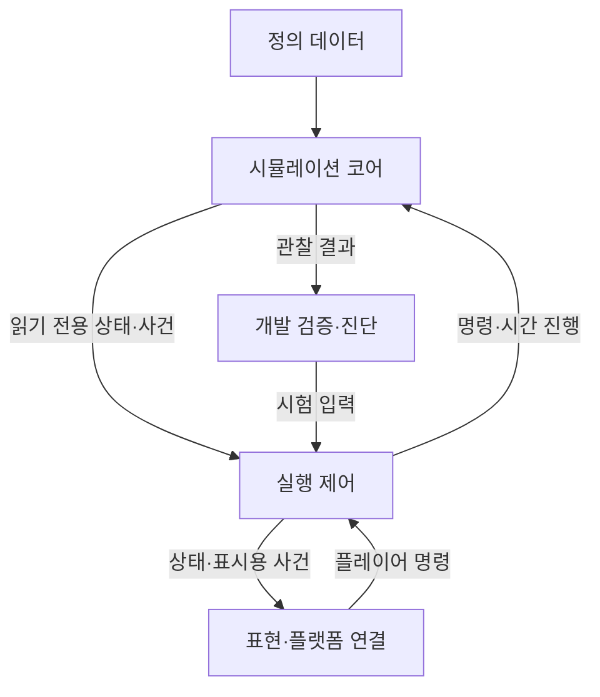

# Project C 소프트웨어 구조 초안 — Q-494 반영

## 범위와 근거

- 사용자 확정: GR-468의 큰 구조 사전 설계, GR-470~474의 규칙/표현 분리·수치 데이터화·개발용 재현 기록·콘텐츠 확장 범위·설계 깊이.
- 아래 모듈 구성과 처리 방식은 위 원칙에서 도출한 설계 초안입니다. 사용자에게 별도로 확인받은 새 게임 규칙이나 실제 구현 결과가 아닙니다.
- 실제 개발은 다른 Windows 머신의 Codex 세션에서 진행합니다. Q-480~482에서 Unity+C#·고정 카메라의3D 모델/픽셀 느낌·Windows x64를 확정했습니다. 기존 코어/표현 분리 구조를 Unity 기준으로 구체화합니다.
- 세부 클래스·함수 명세보다 책임·상태 소유권·흐름·시간 처리·검증 경계를 먼저 정리합니다.

## 모듈과 책임

| 모듈 | 맡는 일 | 다른 모듈과의 연결 |
| --- | --- | --- |
| 정의 데이터 | 가격·품목·시설·레시피·웨이브·지도 초기값과 안정적인 정의 ID | 코어가 읽고 검증하며 화면은 같은 ID의 이름·그림을 연결 |
| 시뮬레이션 코어 | 게임 시계·시설·재고·예약·물류·드론·생산·건설·전투·거래·승패의 상태와 판정 | 입력 명령을 검증하고 상태 변화·사건을 반환. 렌더링·오디오 API에 의존하지 않음 |
| 실행 제어 | 새 판·종료·명령 전달·실제 시간에서 게임 시간 진행·검증 실행 연결 | 동일 코어를 화면 있는 실행과 화면 없는 검사에 연결 |
| 표현 및 플랫폼 연결 | 지도·UI·카메라·픽셀 표현·선택·입력·소리·설정 저장·Windows 실행물 | 코어의 읽기 전용 상태를 표시하고 입력을 명령으로 변환 |
| 개발 검증·진단 | 규칙 검사·수치 검산·성능 측정·버전/초기 조건/주요 명령/오류 상태 기록 | 코어 결과와 실행 환경을 관찰하며 플레이 상태를 임의로 수정하지 않음 |

코어 안의 생산·물류·전투는 각각의 책임으로 나누되 하나의 판 상태를 공유합니다. 별도 서버·네트워크 서비스·범용 플러그인 시스템을 요구하지 않습니다.

## Unity와 3D 표현 연결 — GR-480~484에서 도출

- 코어는 Unity의 Scene·GameObject·렌더링·물리 컴포넌트에 의존하지 않는 C# 규칙 모듈로 구성합니다. 실제 어셈블리/폴더·테스트 도구의 세부 구성은 후속 구현 설계에서 정합니다.
- Unity의3D 모델은 코어의 시설·유닛 식별자에 대응하는 시각 객체로 관리합니다. 높이·회전·작은 기계 동작·표시등·피격 연출은 코어 상태를 반영합니다.
- 128×128격자·실제 점유/충돌 크기·산 차폐·적 이동·드론 직선 비행·터렛 즉시 피해를 유지합니다. 모델 메시나 애니메이션 길이·탄환 이펙트 도착으로 게임 판정을 새로 결정하지 않습니다.
- 화면의 위치 선택은 카메라/3D 표시 좌표에서 코어 격자로 변환하고, 유효한 배치·선택 대상은 실제 점유 상태로 재검사합니다. 시설90도 회전과 고정 카메라 방향은 별개입니다.
- GR-485~488: 게임 장면에 픽셀 느낌을 적용하고 UI·글자는 선명하게 표시합니다. 고정 쿼터뷰 직교 카메라, 일정한 조명/절제된 그림자, 가림을 줄이는 모델 형태·높이와 선택 윤곽 강조를 적용합니다.
- 도출 설계:3D 장면의 픽셀 표현과 UI 합성을 별도 경계로 둡니다. UI 배율을 조정해도 글자가 장면 효과와 함께 거칠어지지 않게 검증합니다. 특정 셰이더·렌더 파이프라인·내부 해상도는 아직 선택하지 않았습니다.
- 선택 윤곽·카메라 선택 판정·시설 점유는 같은 코어 식별자에 연결합니다. 모델 모양을 조정해 가림을 줄여도 실제 점유와 충돌 크기는 유지합니다.
- Windows x64의 ZIP 실행물을 목표로 하며 실제 빌드·오프라인 동작·내장GPU/8GB/전 배속60FPS는 개발 머신과 대상 환경에서 검증합니다.
- 핵심 규칙은 AI가 구현하고 기반 기능은 확인한 무료 패키지를 활용할 수 있습니다. 무료3D 자산과 보정으로 표현을 충족하기 어려우면 사용자와 대안을 논의합니다.

## 상태와 물자의 소유권

| 상태 | 기준 소유자 | 처리 원칙 |
| --- | --- | --- |
| 실물 재고·운반물·벨트 물자·현장 자재·회수 더미 | 코어의 각 보관 위치 | 이동 시 출발 위치 차감과 도착 위치 증가를 한 번의 유효한 이전으로 처리 |
| 출발지 예약·입고 예정·운반 중 집계 | 코어의 작업/예약 관리 | 실물을 복제하지 않음. 입고 예정은 도착 공간 독점이 아니며 실제 도착 시 재검사 |
| 자금·선결제·환불·수출 정산·판 내 거래 내역 | 코어의 거래 관리 | 같은 사건은 한 번만 정산. 수출 인정은 실제 선박 출발 사건 |
| 체력·공격·작업 진행·생산·웨이브·승패 | 코어 | 표시 프레임이나 시각 효과 완료 여부로 판정하지 않음 |
| 선택·호버·카메라·배치 미리보기·창의 미적용 편집값 | 표현/실행 계층 | 확정 명령 전에는 코어의 자원·시설 상태를 변경하지 않음 |
| 언어·음량·키 배정·UI 배율·안내 표시 이력 | 사용자 설정 계층 | 판의 재고/진행 상태와 구분. 기존 즉시/적용 버튼 규칙을 따름 |

재고 예약·이전·소비·반환은 공통 처리 경로에 모읍니다. 드론·벨트·선박이 각자 같은 재고를 다른 방식으로 직접 덮어쓰지 않게 설계합니다. 구체 자료구조와 트랜잭션 구현 방식은 개발 설계에서 정합니다.

## 명령과 데이터 흐름

1. 입력 계층이 시설 선택·버튼·키 입력을 해석합니다. 조작 충돌과 UI/지도 중복 입력은 이 경계에서 막습니다.
2. 실행 제어가 명령의 대상·순서·게임 시각을 코어에 전달합니다. UI는 가능한 비용·결과를 먼저 보여줍니다.
3. 코어가 실제 현재 상태에서 비용·대상·공간·필터·구역 등 조건을 다시 확인합니다. 미리보기의 유효 판정만 신뢰해 실제 상태를 덮어쓰지 않습니다.
4. 유효 명령은 상태 변경과 사건을 생성하고, 무효 명령은 원인과 현재 상태를 반환합니다. 수동 명령을 자동 구매·자동 시설 변경으로 바꾸지 않습니다.
5. UI·지도·경고·소리는 같은 결과에서 정보를 표시합니다. 실제 접안·출발 소리는 해당 코어 사건에서만 발생합니다.
6. 진단 계층은 사용한 버전·정의 데이터·초기 조건·주요 명령과 오류 상태를 연결합니다. GR-477에 따라 로컬 파일에 자동 저장합니다.

## 시간 진행과 같은 시점의 사건

- 게임 시간과 표시 프레임을 분리합니다. 1/2/4배는 같은 규칙의 시간 진행량을 바꾸고 일시정지는 게임 시간을 진행시키지 않습니다. 메뉴·설정·포커스 변화로 자동 정지하지 않습니다.
- 실행 주기는 입력 수집 → 명령의 적용 시점 결정 → 도래한 게임 시각 처리 → 상태 관찰 → 화면/소리 반영으로 설계합니다. 엔진의 개별 오브젝트 갱신 순서에 게임 판정을 맡기지 않습니다.
- 한 프레임이 여러 사건 시각을 넘으면 필요한 사건을 게임 시각 순서대로 처리합니다. 화면 프레임이 늦었다는 이유로 생산·거래·공격 사건을 누락시키거나 더 늦은 수출을 기한 내 출발로 취급하지 않습니다.
- 같은 시점의 명시된 우선순위는 [event-rules.md](event-rules.md)를 따릅니다. 취소는 해당 완공보다 먼저, 치명 피해에 따른 파괴는 수리보다 먼저, 전초기지 파괴 판정은 승리 확정보다 먼저 처리합니다.
- 위 제약만으로 모든 게임 사건의 전역 순서가 결정된 것은 아닙니다. 나머지는 기존 규칙과 물자 보존을 만족하도록 설계하고 결과에 중대한 차이가 나면 사용자에게 질문합니다.
- 정수 시간 표현·고정 간격 갱신·예약 사건의 구체 결합 방식은 후속 기술 선택입니다. 현재 시간표를 근사치로 바꾸거나 작은 간격 사건을 임의로 묶어 생략하지 않습니다.
- 시각 보간은 표시 위치에만 적용합니다. 사거리·충돌·도착·공간 판정의 기준은 코어 상태입니다.

## 데이터와 확장 경계

- 시설·품목·적의 정의는 ID로 참조하며 표시 이름·번역·이미지와 분리합니다. 현재 MVP의 종류·수치·배치를 기본 데이터로 유지합니다.
- 가격·레시피·속도·용량·체력·웨이브 수량 등 수치는 데이터에 모읍니다. 재고 예약·선박 정산·피해·건설 취소 같은 작동 방식은 코드가 책임집니다.
- 같은 동작 유형의 시설·품목·적은 데이터 추가로 확장하기 쉽게 구성합니다. 새로운 작동 방식까지 언제나 데이터만으로 구현할 수 있다고 가정하지 않습니다.
- 정의 ID 중복·참조 누락·잘못된 수량·포트/시설 연결 불일치 등은 데이터 검사 대상으로 둡니다. 검증을 통과하지 않은 수치를 조용히 다른 값으로 치환하지 않습니다.
- 모드 로더·멀티플레이 동기화·여러 지도 제작 도구·사용자용 데이터 편집기는 선행 범위에 포함하지 않습니다.

## 검증 경계

| 경계 | 우선 확인할 내용 | 완료 근거 |
| --- | --- | --- |
| 정의 데이터 → 코어 | 확정 수치와 초기 배치·참조·용량의 일치 | 데이터 검사와 기획 대조 |
| 코어 단독 | 물자 보존·예약·정산·시간 경계·승패·동률 처리 | 화면 없는 자동 검증의 기대 상태 |
| 입력/실행 제어 → 코어 | 명령 한 번 적용·현재 상태 재검사·정지/배속·취소 문맥 | 명령 시나리오와 코어 상태 대조 |
| 코어 → 화면/소리 | UI 재고·경고·체력·선박 상태와 실제 상태 일치 | 직접 조작·화면 관찰 및 기록 |
| 플랫폼 → 최종 실행물 | Windows 실행·오프라인·창 모드·설정 유지·후반/4배속 부하 | 실제 개발/대상 머신의 실행·측정 |

- 실제 테스트는 아직 실행하지 않았습니다. 브라우저 미리보기나 코어 자동 검사만으로 Windows 호환·60FPS·체감 검증을 완료 처리하지 않습니다.
- 개발용 진단은 버그 재현을 돕는 범위입니다. 완전한 판 재생·플레이어용 저장/불러오기·새 게임 모드를 필수화하지 않습니다.
- GR-475~479 반영: 이 기획 세션에서 엔진 선택 → 실제 개발 머신에서 연결/실행 확인. 단축 시험과 정식 한 판 시험을 구분하고, 로컬 진단 기록을 자동 저장하며, 재고·거래·승패 결함의 수정·재검증을 기능 확장보다 우선합니다. 첫 실행물은 ZIP입니다.
- Unity+C#·3D 모델/픽셀 느낌·Windows x64·무료 패키지 활용·자산 부족 시 사용자 논의는 Q-480~484 확정입니다. Q-485~489에서 구체 시각 원칙과 첫 작은 전체 흐름 검증판에서의 대표 장면 검토를 확정했습니다. 세부 렌더링 구현과 실제 검증은 후속입니다.

## 설계자 책임과 인계 — Q-494 및 질문 방식 교정

- 코어 상태 소유권·명령 흐름·시간 처리·모듈 경계는 이 문서의 구조에서 이어서 구체화합니다. 세부 구현 선택마다 사용자에게 대안을 골라 달라고 요구하지 않습니다.
- 조명·후처리·장식 효과의 조정은 기능 식별과 규칙을 유지하며 성능 근거로 수행합니다. BGM은 기본 분위기의 반복이며 추가 음악 반응 시스템은 선행 범위에 포함하지 않습니다.
- 코드·기획·사용 조건이 허용하는 자산의 공개 Git 인계를 준비하고 원본·가공 방법·최종본을 연결합니다. 실제 저장소 생성·게시·프로젝트 생성은 아직 하지 않았습니다.
- 실제 개발 세션 시작 문서는 [development-handoff.md](development-handoff.md)입니다. 미확인 환경·실행 증거는 그 세션에서 확인하며 필요한 사용자 판단과 단순한 기술 확인을 구분합니다.
